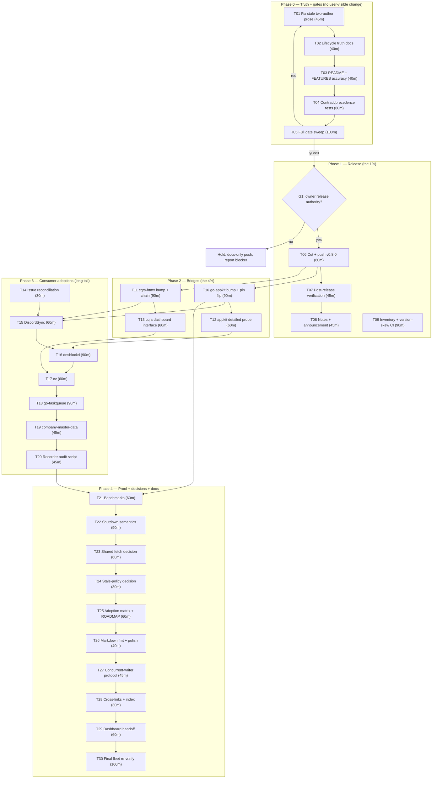

# Supplier Wave Plan — from an unreleased SDK change to fleet adoption

**Created:** 2026-10-27 19:18 CET · **Status:** PARTIALLY EXECUTED, SUPERSEDED by [2026-10-27_21-12_consumption-wave-from-bridges-to-buyers.md](2026-10-27_21-12_consumption-wave-from-bridges-to-buyers.md) · **Repo:** `github.com/larsartmann/go-health`
> **Executed from this plan (2026-10-27):** T01, T02, T03, T04, T05, T06, T07 (proxy + consume),
> T10 (code, not released), T11 (code, not released), T14, and addendum A01–A09. Its central
> premise — "the release is the bottleneck" — has been satisfied: v0.8.1 is published, green, and
> on the proxy. The bottleneck moved to the bridges and the consumers; the successor plan starts
> there. Do NOT re-execute the tasks listed above.
**Predecessors:**
[docs/research/2026-10-27_fleet-consumer-needs.md](../research/2026-10-27_fleet-consumer-needs.md) (needs matrix, 14 needs, 36-consumer reach) ·
[docs/status/2026-10-27_18-57_fleet-consumer-needs-supplier-apis.md](../status/2026-10-27_18-57_fleet-consumer-needs-supplier-apis.md) (session report) ·
[docs/status/2026-10-27_18-57_fleet-needs-supplier-wave-concurrent-session.md](../status/2026-10-27_18-57_fleet-needs-supplier-wave-concurrent-session.md) (second agent's report)

**Input universe:** the 50-item next-list from the session report, the 14 ranked consumer needs, the two open upstream issues (#6, #7), and the peer session's additions (typed identity, `NewWithRecorder`, recorder funcs, federation `Healthz`, selective route mounting).

> **Two plans exist for the same wave.** The peer session wrote
> [`2026-10-27_19-18_supplier-wave-v080-from-primitives-to-fleet.md`](2026-10-27_19-18_supplier-wave-v080-from-primitives-to-fleet.md)
> (701 lines, milestones M01–M27) at the same minute. This file is the
> **execution-order plan** (T01–T30; 155 base subtasks plus a 10-row peer-plan
> addendum in §4b); the peer file is the
> **risk/milestone register** and its unique items are folded into §4b.
> Do not execute both in parallel: until the owner designates a single
> canonical plan, execute this file's T-IDs and read the peer file's trap list
> before each batch.

---

## 0. Where we are (verified 2026-10-27 18:57–19:18)

| Fact             | Value                                                                                                                         |
| ---------------- | ----------------------------------------------------------------------------------------------------------------------------- |
| Release line     | v0.7.0 published; master carries an unreleased wave (drain #5, `SourceStatuses` #6, panic grading #7-F1, seven consumer APIs) |
| Direct consumers | 15 repos; 36 dashboard consumers through 3 bridges                                                                            |
| Bridge pins      | `go-appkit/health` v0.5.1, `cqrs-htmx/health` v0.7.0                                                                          |
| Apps behind      | CV, cv, dnsblockd, KeyHolderAI on v0.5.1                                                                                      |
| Local gates      | build ✅ · tests ✅ · `-race` ✅ · vet ✅ · lint = 1 pre-existing gocognit finding · fmt ✅                                   |
| Unrun gates      | `nix run .#gates`, `docs-check`, `flake check`, OpenAPI lockstep, dprint, consumer suites                                     |
| Tree             | clean; `master...origin/master [ahead 13]` (unpushed, daemon commits)                                                         |
| Blockers         | (G1) release/push authority · (G2) peer-session ownership · (G3) shutdown semantics decision                                  |

**Why this plan exists:** the SDK work is done but **delivers zero customer value until it is released and adopted**. The plan optimizes for that delivery, not for more SDK features.

---

## 1. Pareto — what actually moves the needle

### The 1% that delivers 51% — **one task**

| Slice  | Task                          | Why it is 51%                                                                                                                                                                      |
| ------ | ----------------------------- | ---------------------------------------------------------------------------------------------------------------------------------------------------------------------------------- |
| **1%** | **T06 — Cut and push v0.8.0** | One release makes every queued fix consumable. Until it exists, all research, APIs, and bridge work are invisible to 36 repos. No code change is needed — the artifacts are ready. |

### The 4% that delivers 64% — **release plus both bridges**

| Slice  | Tasks                                                                                     | Why it is 64%                                                                                                                                                       |
| ------ | ----------------------------------------------------------------------------------------- | ------------------------------------------------------------------------------------------------------------------------------------------------------------------- |
| **4%** | **T06** (release) + **T10** (`go-appkit/health` bump) + **T11** (`cqrs-htmx/health` bump) | The two bridges carry go-health into ~24 repos. A release nobody's bridge pins buys nothing; both bumps in the same wave turn one release into fleet-wide delivery. |

### The 20% that delivers 80% — **truth + gates + release + bridges**

| Slice                 | Tasks                                                                                                                                                  | Why it reaches 80%                                                                                                              |
| --------------------- | ------------------------------------------------------------------------------------------------------------------------------------------------------ | ------------------------------------------------------------------------------------------------------------------------------- |
| **~20%** (7/30 tasks) | **T01** stale prose, **T02** lifecycle docs, **T03** README/FEATURES, **T05** gate sweep, **T06** release, **T10** appkit bump, **T11** cqrs-htmx bump | Truth before shipping (no wrong godoc at a tag), gates before tagging, then release + both bridges. This is the delivery spine. |

### The other 80% (long tail) — the last 20% of value

| Slice               | Tasks                                                                                                                                                                                              | What it buys                                                                                                                                                                  |
| ------------------- | -------------------------------------------------------------------------------------------------------------------------------------------------------------------------------------------------- | ----------------------------------------------------------------------------------------------------------------------------------------------------------------------------- |
| **~80%** (23 tasks) | consumer adoptions (T15–T19), tests/bench (T04, T21), decisions (T22–T24), docs/process (T25–T28), dashboard handoff (T29), final fleet verify (T30), issue/announcement follow-through (T08, T14) | Removes the four hand-rolled cache forks, fixes fleet drift, closes the loop on issues, and proves the whole chain. Necessary for 100%, but it cannot start before the spine. |

> **Rule:** no long-tail task may jump the spine. A consumer adoption pinned to an unpublished API is wasted work.

---

## 2. Execution graph

**Critical path:** T01 → T05 → T06 → T10/T11 → T15–T19 → T30 (~13.5 h of the ~30 h total).
**Highest risk edge:** `G1` (release authority) — everything after T06 is idle without it.

---

## 3. Comprehensive plan — 30 tasks, 30–100 minutes each

Order is dependency-respecting execution priority. Score = `(Impact×2 + CustomerValue×2) − Effort/30`, used only to break ties.

| #   | Phase    | Task (30–100 min)                                                                                                                            | Covers (status items) | Impact | Effort | Cust. value | Depends     | Done when                                         |
| --- | -------- | -------------------------------------------------------------------------------------------------------------------------------------------- | --------------------- | ------ | ------ | ----------- | ----------- | ------------------------------------------------- |
| T01 | Truth    | Fix the two-author prose drift: `ChainRecorders` godoc vs `NewWithRecorder`, CHANGELOG recorder sentence, AGENTS source map + ownership note | 9, 10, 17, 18         | 5      | 45m    | 4           | —           | `go doc` text is true; AGENTS ≤220; tests green   |
| T02 | Truth    | Lifecycle truth: document the one-way shutdown latch on `Start`/`Shutdown`, add the `AwaitReady` zero-value caveat                           | 11, 12                | 4      | 40m    | 4           | —           | godoc states the contract; `go doc` proofread     |
| T03 | Truth    | README + FEATURES accuracy: real option count, link to the needs study, recorder-rejection migration note                                    | 15, 16                | 3      | 40m    | 3           | T01         | README/FEATURES/CHANGELOG agree                   |
| T04 | Proof    | Contract tests: `Validate` precedence, `CachedResponse` aliasing, fuzz `SourceStatuses`, `NewWithRecorder`+chain                             | 38, 39, 40, 41        | 4      | 60m    | 3           | T01         | new tests green + race                            |
| T05 | Gate     | Full pre-release gate sweep (build, test, race, vet, lint, fmt, `nix` gates, docs-check, OpenAPI, flake)                                     | 2                     | 5      | 100m   | 5           | T01–T04     | gate log pasted into status report                |
| T06 | Release  | **Cut + push v0.8.0**: CHANGELOG cut, version strings, annotated tag, master push, `gh release create`                                       | 1                     | 5      | 60m    | 5           | T05, **G1** | tag on origin; release page live                  |
| T07 | Release  | Post-release verification: proxy, `go get @latest` smoke, pkg.go.dev, docs-check vs tag, inventory snapshot                                  | 3, 4, 6               | 5      | 45m    | 5           | T06         | evidence recorded                                 |
| T08 | Release  | Release notes + consumer-impact verdict + announcement draft                                                                                 | 5, 8                  | 4      | 45m    | 4           | T06         | notes name additive/changed/fixed + bridge impact |
| T09 | Release  | Re-derive the consumer inventory + build the version-skew CI script                                                                          | 6, 7                  | 4      | 90m    | 4           | T06, **G1** | script fails on drift; doc matches live pins      |
| T10 | Bridge   | `go-appkit/health` bump to v0.8.0; flip warn→fail pin; replace recorder-trap docs; rejection test                                            | 19, 20, 21, 23        | 5      | 90m    | 5           | T06         | bridge suite + integration green                  |
| T11 | Bridge   | `cqrs-htmx/health` bump to v0.8.0; replace its `RecorderChain` with `health.ChainRecorders`; duration test                                   | 24, 25, 26            | 5      | 90m    | 5           | T06         | bridge suite green; durations proven              |
| T12 | Bridge   | `appkithealth.NewDetailedProbe` (detailed map → `duration_ns`)                                                                               | 22                    | 3      | 60m    | 3           | T10         | example + test green                              |
| T13 | Bridge   | Widen `cqrs-htmx/health.NewDashboard` to the dashboard `Prober` interface + conformance assertion                                            | 27, 28                | 4      | 60m    | 4           | T11         | aggregate/federation compile through the bridge   |
| T14 | Loop     | Annotate/close issues #6 and #7 (F1 fixed, F2 shipped as Start rejection, F3 fixed, F4 pending)                                              | 13, 14                | 3      | 30m    | 2           | T06         | issue state truthful                              |
| T15 | Adopt    | DiscordSync: `CachedResponseFresh` + `EvaluateAndCache` replace `readyzSnapshotCache` mechanics                                              | 29                    | 4      | 60m    | 4           | T10, T11    | suite green; 2× interval policy kept              |
| T16 | Adopt    | dnsblockd: `CacheAge` replaces the timestamp check; `Response.Clone` replaces the manual clone; overlay kept                                 | 30                    | 4      | 90m    | 4           | T10, T11    | stale path behavior pinned                        |
| T17 | Adopt    | cv: fresh-cache read + `EvaluateAndCache` + `Clone`; synthetic-row domain rule unchanged                                                     | 31                    | 4      | 60m    | 4           | T10, T11    | suite green; off→warn rule intact                 |
| T18 | Adopt    | go-taskqueue: migrate `queueProber` to `health.NewChecks`; preserve startup/readiness semantics                                              | 32                    | 4      | 90m    | 4           | T10, T11    | ~120 lines deleted; suite green                   |
| T19 | Adopt    | company-master-data: wire `checks.Disk(cfg.DataDir, minFreeBytes)`                                                                           | 33                    | 3      | 45m    | 4           | T10         | e2e green; disk row visible                       |
| T20 | Adopt    | Fleet recorder mis-wire audit script (rejecting constructors)                                                                                | 34                    | 3      | 45m    | 3           | T06         | script green across 15 repos                      |
| T21 | Proof    | Benchmarks: `CachedResponseFresh` (0 alloc), `EvaluateAndCache`, multi-remote `SourceStatuses`                                               | 35, 36, 37            | 3      | 60m    | 2           | T11         | numbers recorded in FEATURES                      |
| T22 | Decision | Shutdown semantics: decide re-arm vs one-way, implement the choice, update docs/tests                                                        | Q3, 11                | 4      | 90m    | 3           | T02         | decision + implementation + fleet note            |
| T23 | Decision | `SourceStatuses` fetch cost: measure, then share one pass or keep 2× with docs                                                               | 48                    | 2      | 60m    | 2           | T21         | decision recorded with numbers                    |
| T24 | Decision | `WithStaleAfter` policy: final decision record (reject with rationale, or ship)                                                              | 49                    | 2      | 30m    | 2           | T02         | decision doc linked from overlay note             |
| T25 | Docs     | Adoption matrix + ROADMAP: seven new capabilities, fifth pattern, raw ideas                                                                  | 43, 44                | 3      | 60m    | 2           | T11         | matrix matches the fleet                          |
| T26 | Docs     | Markdown formatting (`nix fmt`/dprint) + docs-check + polish                                                                                 | 45                    | 2      | 40m    | 2           | T25         | diff reviewed, gate green                         |
| T27 | Process  | Concurrent-writer preflight + intent-commit policy in AGENTS/CONTRIBUTING                                                                    | 42, 46                | 4      | 45m    | 2           | —           | protocol written and followed                     |
| T28 | Docs     | Cross-link both 18:57 status reports from the research doc; add this plan to the index                                                       | 47                    | 2      | 30m    | 2           | —           | one entry point per wave                          |
| T29 | Handoff  | Dashboard-family asks: `HTMLDataAttrs` (fir DD9), dashboard#14, dashboard#17                                                                 | N14                   | 4      | 60m    | 4           | —           | drafted/filed per owner gate                      |
| T30 | Verify   | Final fleet verification: go-health + 2 bridges + 4 consumers + inventory recheck                                                            | 50                    | 5      | 100m   | 5           | T10–T19     | one evidence table, all green                     |

**Totals:** 30 tasks · ~1,820 minutes (~30 h) · 7 tasks (≈20%) deliver the first 80% of value.
The peer-plan addendum (§4b) adds 10 subtasks (~108 min) and is part of Phase 0–1.

---

## 4. 12-minute breakdown — every task sliced, sorted by execution order

Each row is ≤12 minutes. `V:` is the verification that closes the row (no "looks fine").

| ID   | ≤12-min task                                                                | Min | V                                               |
| ---- | --------------------------------------------------------------------------- | --- | ----------------------------------------------- |
| 01.1 | Rewrite `ChainRecorders` godoc to include `NewWithRecorder` (injector-free) | 6   | `go doc` reads true                             |
| 01.2 | Reword CHANGELOG recorder sentence: name the three rejecting constructors   | 6   | grep finds no "function-path constructor" claim |
| 01.3 | Add `new_with_recorder.go` + `service_name.go` to the AGENTS source map     | 10  | `wc -l AGENTS.md` ≤220                          |
| 01.4 | Add a two-author ownership note in `recorder.go`; reconcile AGENTS bullets  | 10  | diff review                                     |
| 01.5 | Proofread greps + run `go test ./...`                                       | 10  | suite green                                     |
| 02.1 | Add one-way-latch paragraph to `Start` godoc                                | 5   | `go doc Probe.Start`                            |
| 02.2 | Add the same contract to `Shutdown` + cross-reference                       | 5   | `go doc Probe.Shutdown`                         |
| 02.3 | Add `AwaitReady` zero-value caveat; point to `StartupComplete`/`CacheAge`   | 10  | `go doc Probe.AwaitReady`                       |
| 02.4 | Proofread + `go test ./...`                                                 | 10  | suite green                                     |
| 03.1 | Verify the real option count; fix FEATURES "12 total"                       | 10  | count matches `With*` in options                |
| 03.2 | Add README link to the needs study                                          | 5   | link resolves                                   |
| 03.3 | Add README migration note for recorder rejection                            | 10  | README/CHANGELOG agree                          |
| 03.4 | Consistency grep + commit                                                   | 10  | grep clean                                      |
| 04.1 | Add `Validate` precedence test (recorder + bad timeout)                     | 10  | test green                                      |
| 04.2 | Add `CachedResponse` aliasing contract test                                 | 10  | test green                                      |
| 04.3 | Add `FuzzSourceStatuses_Invariants` + seed                                  | 12  | `go test -run Fuzz` green                       |
| 04.4 | Add `NewWithRecorder`+`ChainRecorders` integration test                     | 10  | test green                                      |
| 04.5 | Run test + race + lint                                                      | 12  | all green                                       |
| 05.1 | `go build ./...` + `go test -count=1 ./...`                                 | 12  | 5/5 ok                                          |
| 05.2 | `go test -race ./...`                                                       | 12  | 5/5 ok                                          |
| 05.3 | `go vet` + `golangci-lint run ./...`                                        | 10  | only pre-existing gocognit                      |
| 05.4 | `gofmt`/`gofumpt`/`goimports` checks                                        | 10  | no new output                                   |
| 05.5 | `nix run .#gates`                                                           | 12  | exit 0 or documented blocker                    |
| 05.6 | `nix run .#docs-check` + `.#openapi-lockstep`                               | 12  | both green                                      |
| 05.7 | `nix flake check`                                                           | 12  | green or documented env blocker                 |
| 05.8 | Paste the gate log into the status report                                   | 8   | evidence present                                |
| 06.1 | Cut CHANGELOG `[Unreleased]` → `[v0.8.0] - 2026-10-27`                      | 10  | heading present                                 |
| 06.2 | Sweep version strings (README, AGENTS, FEATURES)                            | 10  | `grep v0.7.0` justified                         |
| 06.3 | Create annotated tag + push tag                                             | 10  | `git ls-remote --tags` shows it                 |
| 06.4 | Push master                                                                 | 5   | `git status -sb` not ahead                      |
| 06.5 | `gh release create` + verify page                                           | 12  | release URL responds                            |
| 07.1 | Proxy propagation check                                                     | 12  | `go list -m -versions` shows v0.8.0             |
| 07.2 | pkg.go.dev render check                                                     | 8   | page renders                                    |
| 07.3 | `go get @latest` in a throwaway module                                      | 10  | build green                                     |
| 07.4 | `nix run .#docs-check` against the new tag                                  | 10  | green                                           |
| 07.5 | Record evidence in the status report                                        | 5   | table row                                       |
| 08.1 | Write the additive/changed/fixed consumer-impact verdict                    | 10  | names the 3 groups                              |
| 08.2 | Write the bridge-bump checklist                                             | 10  | both bridges listed                             |
| 08.3 | Draft the v0.8.0 announcement                                               | 12  | file exists                                     |
| 08.4 | Proofread/voice pass                                                        | 8   | no overclaim                                    |
| 09.1 | Script skeleton `scripts/version-skew.sh`                                   | 8   | runs                                            |
| 09.2 | Enumerate repos + parse `go.mod` pins                                       | 10  | 15 rows                                         |
| 09.3 | Query latest tags + compare                                                 | 12  | drift detected                                  |
| 09.4 | Output table + non-zero exit on drift                                       | 10  | deliberate drift test                           |
| 09.5 | Wire into gates/docs                                                        | 10  | referenced                                      |
| 09.6 | Re-derive the consumer inventory                                            | 12  | 36/15 confirmed                                 |
| 09.7 | Update `consumer-verification.md`                                           | 10  | doc matches script                              |
| 09.8 | Run + record                                                                | 8   | green run captured                              |
| 10.1 | Bump `go-appkit/health` go.mod to v0.8.0                                    | 5   | `go mod tidy` clean                             |
| 10.2 | Flip `probe_test.go` warn→fail                                              | 10  | test green                                      |
| 10.3 | Replace the recorder-trap godoc with the Start-rejection contract           | 10  | godoc true                                      |
| 10.4 | Add the rejection test                                                      | 10  | test green                                      |
| 10.5 | Run the health module suite                                                 | 12  | green                                           |
| 10.6 | Run the integration module suite                                            | 12  | green                                           |
| 10.7 | Flake input/vendor pin update                                               | 12  | `nix build` green                               |
| 10.8 | Commit + record evidence                                                    | 8   | commit exists                                   |
| 11.1 | Bump `cqrs-htmx/health` go.mod to v0.8.0                                    | 5   | tidy clean                                      |
| 11.2 | Replace `RecorderChain` with `health.ChainRecorders`                        | 12  | compiles                                        |
| 11.3 | Update the chain godoc (durations survive)                                  | 8   | true                                            |
| 11.4 | Add the duration-survival test                                              | 10  | test green                                      |
| 11.5 | Run health + integration suites                                             | 12  | green                                           |
| 11.6 | Flake/vendor pin update                                                     | 12  | build green                                     |
| 11.7 | Call-site audit for the deleted type                                        | 10  | no references                                   |
| 11.8 | Commit + record                                                             | 8   | commit exists                                   |
| 12.1 | Design the `NewDetailedProbe` signature                                     | 10  | written in issue/PR                             |
| 12.2 | Implement via `NewWithDetailedCheck`                                        | 12  | compiles                                        |
| 12.3 | Add test + runnable example                                                 | 12  | example output pinned                           |
| 12.4 | Godoc + README note                                                         | 10  | true                                            |
| 12.5 | Suite + commit                                                              | 10  | green                                           |
| 13.1 | Define the minimal dashboard-prober interface                               | 10  | interface compiles                              |
| 13.2 | Change `NewDashboard` signature                                             | 10  | bridge compiles                                 |
| 13.3 | Add compile-time assertion + tests                                          | 12  | aggregate/federation accepted                   |
| 13.4 | Update docs/examples                                                        | 10  | no stale `*Probe` claim                         |
| 13.5 | Suite + commit                                                              | 10  | green                                           |
| 14.1 | Draft the #7 status comment                                                 | 12  | covers F1–F4                                    |
| 14.2 | Post #7 comment + close/annotate #6                                         | 8   | issue state truthful                            |
| 14.3 | Record in TODO/status                                                       | 8   | row present                                     |
| 15.1 | Read `readyzSnapshotCache` + its tests                                      | 10  | behavior map written                            |
| 15.2 | Replace mechanics with `CachedResponseFresh` + `EvaluateAndCache`           | 12  | compiles                                        |
| 15.3 | Keep the 2× interval policy + adjust tests                                  | 12  | test green                                      |
| 15.4 | Run the suite                                                               | 12  | green                                           |
| 15.5 | Commit + record                                                             | 8   | commit exists                                   |
| 16.1 | Read `health.go` + `degradeStaleHealth` tests                               | 10  | behavior map written                            |
| 16.2 | Swap the timestamp check for `CacheAge`                                     | 10  | compiles                                        |
| 16.3 | Swap the manual clone for `Response.Clone`                                  | 10  | compiles                                        |
| 16.4 | Update/extend the stale-path tests                                          | 12  | green                                           |
| 16.5 | Run the suite                                                               | 12  | green                                           |
| 16.6 | Flake/vendor pin update                                                     | 12  | build green                                     |
| 16.7 | Commit + record                                                             | 8   | commit exists                                   |
| 17.1 | Read `project()` + synthetic-row tests                                      | 10  | behavior map written                            |
| 17.2 | Replace fallback + clone                                                    | 12  | compiles                                        |
| 17.3 | Keep the off→warn domain rule; adjust tests                                 | 12  | green                                           |
| 17.4 | Run the suite                                                               | 12  | green                                           |
| 17.5 | Commit + record                                                             | 8   | commit exists                                   |
| 18.1 | Read `queueProber` + webui tests                                            | 10  | behavior map written                            |
| 18.2 | Map its checks onto `health.NewChecks`                                      | 10  | names preserved                                 |
| 18.3 | Replace `CachedResponse`/handlers with the probe                            | 12  | compiles                                        |
| 18.4 | Preserve startup/readiness semantics                                        | 12  | tests green                                     |
| 18.5 | Extend the tests                                                            | 12  | green                                           |
| 18.6 | Run the suite                                                               | 12  | green                                           |
| 18.7 | Commit + record                                                             | 8   | commit exists                                   |
| 19.1 | Read the company-master-data probe wiring                                   | 10  | call site identified                            |
| 19.2 | Add `checks.Disk(cfg.DataDir, …)`                                           | 10  | compiles                                        |
| 19.3 | Extend the e2e/health test                                                  | 12  | green                                           |
| 19.4 | Run the suite + commit                                                      | 10  | green                                           |
| 20.1 | Define the mis-wire grep rule                                               | 10  | rule written                                    |
| 20.2 | Write the script over the repo list                                         | 12  | runs                                            |
| 20.3 | Run + wire into gates                                                       | 12  | green                                           |
| 20.4 | Commit + record                                                             | 8   | commit exists                                   |
| 21.1 | Add `BenchmarkCachedResponseFresh`                                          | 10  | 0 allocs proven                                 |
| 21.2 | Add `BenchmarkEvaluateAndCache`                                             | 10  | ns/op recorded                                  |
| 21.3 | Add multi-remote `BenchmarkSourceStatuses`                                  | 12  | 1/2/4/8 rows                                    |
| 21.4 | Record numbers in FEATURES                                                  | 10  | provenance noted                                |
| 21.5 | Commit                                                                      | 8   | commit exists                                   |
| 22.1 | Write the shutdown-semantics decision record                                | 12  | doc exists                                      |
| 22.2 | Implement the chosen behavior                                               | 12  | compiles                                        |
| 22.3 | Add/adjust tests                                                            | 12  | green                                           |
| 22.4 | Update docs + go-appkit note                                                | 10  | consistent                                      |
| 22.5 | Run the suite                                                               | 10  | green                                           |
| 22.6 | Commit                                                                      | 8   | commit exists                                   |
| 23.1 | Measure the 2× fetch cost                                                   | 10  | numbers captured                                |
| 23.2 | Decide share-vs-document                                                    | 12  | decision written                                |
| 23.3 | Implement or document                                                       | 12  | code/doc lands                                  |
| 23.4 | Tests + commit                                                              | 10  | green                                           |
| 24.1 | Write the `WithStaleAfter` decision record                                  | 10  | doc exists                                      |
| 24.2 | Cross-reference from the overlay note                                       | 10  | links resolve                                   |
| 24.3 | Commit                                                                      | 8   | commit exists                                   |
| 25.1 | Update the adoption matrix (7 capabilities)                                 | 12  | rows present                                    |
| 25.2 | Update ROADMAP raw ideas                                                    | 12  | ideas routed                                    |
| 25.3 | Proofread                                                                   | 10  | no stale counts                                 |
| 25.4 | Commit                                                                      | 8   | commit exists                                   |
| 26.1 | Run `nix fmt`/dprint                                                        | 12  | no output                                       |
| 26.2 | Review the formatted diff                                                   | 10  | only whitespace                                 |
| 26.3 | Run docs-check                                                              | 10  | green                                           |
| 26.4 | Commit                                                                      | 8   | commit exists                                   |
| 27.1 | Add the concurrent-writer preflight to AGENTS                               | 12  | ≤220 lines                                      |
| 27.2 | Add the intent-commit rule to CONTRIBUTING/AGENTS                           | 10  | rule present                                    |
| 27.3 | Add the HEAD/mtime detection snippet                                        | 10  | runs                                            |
| 27.4 | Commit                                                                      | 8   | commit exists                                   |
| 28.1 | Cross-link both status reports from the research doc                        | 10  | links resolve                                   |
| 28.2 | Add this plan to `docs/INDEX.md`                                            | 10  | row present                                     |
| 28.3 | Commit                                                                      | 8   | commit exists                                   |
| 29.1 | Draft the `HTMLDataAttrs` ask (fir DD9)                                     | 12  | draft file                                      |
| 29.2 | Draft dashboard#14 note                                                     | 10  | draft file                                      |
| 29.3 | Draft dashboard#17 note                                                     | 10  | draft file                                      |
| 29.4 | Hand off / file per owner gate                                              | 12  | recorded                                        |
| 29.5 | Commit                                                                      | 8   | commit exists                                   |
| 30.1 | go-health suite + race                                                      | 12  | green                                           |
| 30.2 | Both bridge suites                                                          | 12  | green                                           |
| 30.3 | DiscordSync suite                                                           | 12  | green                                           |
| 30.4 | dnsblockd suite                                                             | 12  | green                                           |
| 30.5 | cv suite                                                                    | 12  | green                                           |
| 30.6 | go-taskqueue suite                                                          | 12  | green                                           |
| 30.7 | Inventory recheck                                                           | 10  | matches script                                  |
| 30.8 | Final evidence table + commit                                               | 8   | all green                                       |

**Subtask total:** 155 rows · sum of estimates ≈ 1,560 min (the 30-task table carries ~260 min of contingency/retries).

---

## 4b. Peer-plan merge addendum — unique items folded in

The peer plan (M01–M27) caught six things this plan's first draft missed. They are **not
optional**: the panic-grading change is a behavior change and needs an ADR; the federation
docs are now lying about `Healthz`; the dependency claims are stale. Each row is ≤12 minutes
and belongs to the phase shown.

| ID  | ≤12-min task                                                                                                        | Min | Phase / parent | V                                       |
| --- | ------------------------------------------------------------------------------------------------------------------- | --- | -------------- | --------------------------------------- |
| A01 | Write ADR-008: a recovered panic always fails closed (both recovery surfaces)                                       | 12  | 0 / T01        | ADR file exists, linked from panic doc  |
| A02 | Add CHANGELOG migration snippets: non-critical panic 200/warn → 503/fail                                            | 10  | 0 / T01        | snippet present                         |
| A03 | Add CHANGELOG migration snippet: `ErrRecorderNotApplicable` path                                                    | 8   | 0 / T01        | snippet present                         |
| A04 | Flip `docs/federation-healthz-design.md` status to IMPLEMENTED (it still says "do NOT implement opportunistically") | 8   | 0 / T01        | header truthful                         |
| A05 | Add `SourceStatuses` + `Healthz` sections to `docs/federation-design.md`                                            | 10  | 0 / T01        | cross-linked                            |
| A06 | Reconcile dependency claims: README/AGENTS "single dependency" vs `samber/go-type-to-string` (peer change)          | 10  | 0 / T03        | grep finds no false "single dependency" |
| A07 | Reconcile FEATURES option count (13 with `WithCriticalService[T]`) and the new rows                                 | 10  | 0 / T03        | count matches `With*`                   |
| A08 | Fix the last lint finding: extract a helper in `FuzzResponseMarshalDeterministic` (gocognit 26→≤25, no nolint)      | 12  | 0 / T04        | `golangci-lint` exit 0                  |
| A09 | Add INDEX rows for every doc touched by A01–A08                                                                     | 8   | 0 / T03        | rows present                            |
| A10 | Run `nix run .#docs-check` after the addendum                                                                       | 10  | 0 / T05        | exit 0                                  |

**Plan-to-plan mapping (so nothing is lost):**

| Peer milestones                                           | This plan              |
| --------------------------------------------------------- | ---------------------- |
| M01 lint/test/race/vet gates                              | T04, T05, A08          |
| M02 doc truth (federation/Healthz, deps, FEATURES, INDEX) | T01, T03, A04–A07, A09 |
| M03 panic ADR + migration + issue annotation              | T01, T14, A01–A03      |
| M04 release mechanics                                     | T06, T07               |
| M05 cqrs-htmx bridge                                      | T11, T13               |
| M06 go-appkit bridge                                      | T10, T12               |
| M07 bridge smoke                                          | T30                    |
| M08–M11 consumer adoptions                                | T15–T19                |
| M12–M17 tests/bench/fuzz/decisions                        | T04, T21–T24           |
| M18–M27 docs/process/handoff                              | T08, T09, T20, T25–T29 |

**Additional peer guardrails adopted here:** no wire-format change in this wave; one repository
per commit; never move a published tag (cut v0.8.1 instead); no opportunistic refactors —
every touched file is named by a subtask; when writes race, prefer creating a new file over
rewriting a shared one.

---

## 5. Gates and verification per phase

| Phase | Gate            | Command / evidence                                              | Fail action                  |
| ----- | --------------- | --------------------------------------------------------------- | ---------------------------- |
| 0     | Local suite     | `GOWORK=off go test -race ./...`                                | stop, fix, re-run            |
| 0     | Lint            | `GOWORK=off golangci-lint run ./...`                            | fix or document pre-existing |
| 0     | Formatters      | `gofmt -l`, `gofumpt -l`, `goimports -l`                        | fix                          |
| 0     | Canonical gates | `nix run .#gates`                                               | stop the release             |
| 0     | Docs/OpenAPI    | `nix run .#docs-check`, `.#openapi-lockstep`                    | fix before tag               |
| 1     | Release         | annotated tag on origin + `gh release view`                     | do not bump bridges          |
| 1     | Proxy           | `go get @latest` in a temp module                               | wait/retry, then report      |
| 2     | Bridge suites   | each module's own `go test -race ./...`                         | no consumer edits            |
| 2     | Bridge builds   | flake build / `nix build` for each repo                         | pin fix first                |
| 3     | Consumer suites | per-repo `go test ./...` (+ e2e where present)                  | revert only that adoption    |
| 4     | Final           | T30 evidence table: 1 SDK + 2 bridges + 4 consumers + inventory | stop, do not claim done      |

**Never:** tag before T05; bump a bridge before T06; edit a consumer before its bridge bump; mark a task done without its `V:`.

---

## 6. Verschlimmbesser guards (non-negotiable)

1. **Additive first.** No API removal, no wire change, no default flip in this plan (shutdown re-arm is decision-gated, T22).
2. **One ship in flight.** Do not start T10/T11 before T06 is verified; do not tag twice in one wave.
3. **Behavior changes get a CHANGELOG `Changed` line + a consumer-impact note.** The recorder rejection is the precedent.
4. **Never revert a peer session's work.** Read it, judge it, reconcile it; the two-author `recorder.go` stays.
5. **Do not edit a consumer repo without its owner's go-ahead** (G2/G3 territory). Draft the diff and ask.
6. **Verify the delivering layer, not the commit** — a bridge bump is done when its suite runs against the new tag, not when go.mod changed.
7. **Stop the line on red.** A failing gate is never "probably unrelated".
8. **AGENTS.md stays ≤220 lines**; new detail goes to a linked design note.
9. **No new dependency** for this work (the peer's `go-type-to-string` is a separate decision to reconcile, not to extend).
10. **Push plan/docs freely; never tag or push a release without G1.**
11. **No wire-format change in this wave** (peer guardrail): `encoding/json/v2` output is frozen.
12. **One repository per commit** (peer guardrail): a broken consumer tree is reverted for that repo only.
13. **No tag moves** (peer guardrail): if v0.8.0 is wrong, cut v0.8.1.
14. **No opportunistic refactors** (peer guardrail): every touched file is named by a subtask.
15. **When writes race, prefer a new file** over rewriting a shared one (peer guardrail, learned from `recorder.go`).

---

## 7. Definition of done (whole wave)

- v0.8.0 is tagged, on the proxy, and has a release page with a consumer-impact verdict.
- `go-appkit/health` and `cqrs-htmx/health` are bumped and green against v0.8.0; their old recorder workarounds are deleted.
- DiscordSync, dnsblockd, cv, go-taskqueue compile against the released API and no longer carry hand-rolled cache adapters (3 of 4 fully deleted; dnsblockd keeps its domain overlay).
- Issues #6 and #7 are closed/annotated; the needs study and both status reports are cross-linked.
- Version-skew is detectable by script; the inventory matches the live pins.
- Final evidence table in a status report: all suites green, every claim linked.

---

## 8. Open owner gates

| Gate   | Question                                                                                                                                                  | Blocks                   |
| ------ | --------------------------------------------------------------------------------------------------------------------------------------------------------- | ------------------------ |
| **G1** | May I cut/tag/push v0.8.0 (and bump both bridges)?                                                                                                        | T06–T11, all adoptions   |
| **G2** | Are the peer session's files (`new_with_recorder.go`, `service_name.go`, README, `go.mod`, `handlers.go`) final, and who reconciles the overlapping docs? | T01/T03 truth fixes, T27 |
| **G3** | Shutdown semantics: keep one-way (docs only) or make `Start` re-arm?                                                                                      | T22                      |
| **G4** | May I edit consumer repos (DiscordSync, dnsblockd, cv, go-taskqueue, company-master-data) directly?                                                       | T15–T19                  |

---

## Appendix — evidence map

| Claim                                          | Source                                                                                                                     |
| ---------------------------------------------- | -------------------------------------------------------------------------------------------------------------------------- |
| 15 direct / 36 dashboard consumers / 3 bridges | `docs/research/2026-10-27_fleet-consumer-needs.md` §1                                                                      |
| Version skew (v0.5.1 apps, bridge pins)        | same §1, commands reproduced                                                                                               |
| Four cache forks                               | §N1 (DiscordSync `health_readyz_cache.go:60`, dnsblockd `health.go:96`, cv `handlers.go:124`, go-taskqueue `health.go:86`) |
| Aliasing hazard                                | §N3 (`dnsblockd health.go:121`, `cv handlers.go:131`, `docs/synthetic-check-overlay.md`)                                   |
| Recorder trap                                  | §N5, go-health#7 F2, `go-appkit/health/probe.go:25`                                                                        |
| Chain duration loss                            | §N6, `cqrs-htmx/health/probe.go:97`                                                                                        |
| Federation per-remote gap                      | §N8, go-health#6                                                                                                           |
| Current gate state                             | session report §4 (build/test/race/vet/lint/fmt)                                                                           |
