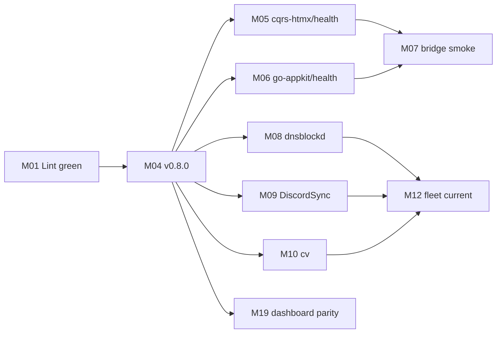

# Supplier wave: v0.8.0 from primitives to fleet adoption — master plan

**Date:** 2026-10-27 19:18 CET (gate state re-verified 19:26)
**Repo:** `~/projects/go-health` · **Base:** master `3245d27` (13 commits ahead of `origin/master`, all unreleased on top of v0.7.0)
**Author:** Crush (this session) · **Companion report:** [`docs/status/2026-10-27_18-57_fleet-needs-supplier-wave-concurrent-session.md`](../status/2026-10-27_18-57_fleet-needs-supplier-wave-concurrent-session.md)
**Research input:** [`docs/research/2026-10-27_fleet-consumer-needs.md`](../research/2026-10-27_fleet-consumer-needs.md)
**Sibling plan:** [`docs/planning/2026-10-27_19-18_fleet-supplier-wave-release-plan.md`](2026-10-27_19-18_fleet-supplier-wave-release-plan.md) (peer agent, execution-order T01–T30, 155 subtasks)
**Scope:** go-health (SDK + aggregate + federation + checks) **and** the three delivery layers that multiply it: `cqrs-htmx/health`, `go-appkit/health`, `go-health-dashboard`.

> **Coordination note (read first).** Two plans exist for the same wave, written
> at the same minute by two agents. This file is the **milestone + risk register**
> (M01–M27, Pareto tiers, dependency graph, verification matrix). The peer file
> is the **execution-order plan** (T01–T30, 30/60/100-min slices, owner gates
> G1–G4). They agree on the critical path (gate → v0.8.0 → bridges → adoption).
> **Do not execute both in parallel.** Until the owner designates a canonical
> plan, execute the peer file's T-IDs and consult this file's trap list, risk
> register, and verification matrix before each batch. Reconciliation of the
> two is item one of the next session, not a reason to block the release.

---

## 1. Why this plan exists

go-health is no longer a single-repo concern. The 2026-10-27 sweep verified:

| Reach layer                        | Carriers                                                                                                                                                                                                                            | Count |
| ---------------------------------- | ----------------------------------------------------------------------------------------------------------------------------------------------------------------------------------------------------------------------------------- | ----- |
| Direct `require`                   | 16 local repos (CV, cv, DiscordSync, dnsblockd, file-and-image-renamer, go-health-dashboard, go-taskqueue, KeyHolderAI, library-policy, nsfw-classifier, PMA, timesheets, webphone, Zlota44, company-master-data, cqrs-htmx/health) | 16    |
| Bridge `cqrs-htmx/health`          | every cqrs-htmx app that mounts health                                                                                                                                                                                              | ~20   |
| Bridge `go-appkit/health`          | appkit services + integration suite                                                                                                                                                                                                 | 4+    |
| Presentation `go-health-dashboard` | full inventory                                                                                                                                                                                                                      | 36    |

Master now carries a wave of unreleased work (drain, `SourceStatuses`, `Response.Clone`, cache freshness, `ErrRecorderNotApplicable`, `ChainRecorders`, typed critical identity, injector-free recorder constructor, recorder function adapters, federation `Healthz`, selective routes, panic grading fix). **Not one consumer can use any of it until v0.8.0 is tagged and the two bridges bump.** That is the central supplier fact this plan is built around.

### Verified starting state

| Gate                                                                 | State                                                                                                                         |
| -------------------------------------------------------------------- | ----------------------------------------------------------------------------------------------------------------------------- |
| `go build ./...`                                                     | PASS                                                                                                                          |
| `go test -count=1 ./...`                                             | PASS (5/5 packages)                                                                                                           |
| `go vet ./...`                                                       | PASS                                                                                                                          |
| `gofmt -l .`                                                         | PASS                                                                                                                          |
| `golangci-lint run ./...`                                            | **RED: 1 finding** (`gocognit` in `handlers_fuzz_test.go`); the 3× err113 + 1× wsl_v5 findings from 19:18 were fixed at 19:24 |
| `go test -race ./...`                                                | PASS per the peer plan's 19:18 snapshot; re-run before the tag                                                                |
| `nix run .#gates` / `.#fuzz` / `.#docs-check` / `.#openapi-lockstep` | NOT RUN                                                                                                                       |
| BuildFlow full mode                                                  | NOT RUN                                                                                                                       |

### Known traps (do not re-learn them)

- A second Crush session edited this repo during the 18:00-19:00 hour and may do so again. **Check `git status`, `git log --since`, and file mtimes before every batch; prefer new files when writes race.**
- The auto-commit daemon commits every few minutes. Never assume "my change is uncommitted"; inspect `git show`/`git diff` before rewriting shared files.
- `AGENTS.md` is at **219/220 lines**. Any net addition trips `docs-check`.
- `federation-go-healthz-design.md` still says "do NOT implement opportunistically" while the implementation exists. Documentation truth is part of the release gate.
- go-appkit/health v0.5.1 pins the **old warn behavior** for a non-critical panic. It goes red the moment it bumps; the pin flip must ride the same consumer change.
- Four consumers (DiscordSync, dnsblockd, cv, go-taskqueue) hand-roll the same cache adapter; go-taskqueue reimplements the entire `dashboard.Prober`.
- `encoding/json/v2` wire format is frozen. **No wire-shape change in this wave.**
- No secrets, no remote pushes beyond the explicit instruction for this commit.

---

## 2. Non-negotiables (the anti-Verschlimmbesserung contract)

1. **Additive first.** No wire-format change, no option-default flip, no removal in this wave. The one behavior change (panic grading) ships with an ADR, a migration snippet, and a consumer pin flip.
2. **Green before tag.** `lint + test + race + vet + docs-check` before `git tag`. No exceptions, no "the tail looked green".
3. **One repository per commit.** Consumer bumps are separate commits per repo; a broken tree is reverted for that repo only.
4. **No tag moves.** If v0.8.0 is wrong, cut v0.8.1; never re-tag a published version.
5. **No opportunistic refactors.** Every file touched must be named in a subtask below. Cosmetic rewrites are out of scope.
6. **Keep the cap.** AGENTS.md must stay ≤220 lines; move detail to `docs/INDEX.md`.
7. **Preserve consumer semantics.** Any hand-rolled behavior replaced by a primitive must be pinned by the consumer's existing tests before deletion.
8. **Explicit verification per step.** Every subtask below has a Definition of Done; a task is not done when the edit compiles, but when its DoD command passes.
9. **Respect concurrent writers.** If a file changed since your read, re-read before editing. Never revert another session's work.
10. **Commit messages explain why**, not which files changed.

---

## 3. Pareto map

The percentages below are **value-unlock shares**, deliberately not effort shares. The reason they diverge is the fleet topology: release mechanics are a few hours of work but gate 100% of downstream value.

### 3.1 The 1% that delivers 51% — _ship the release_

**M04 (cut v0.8.0), gated only by M01 (lint green).**

Nothing else reaches a consumer without the tag. Every adopted primitive, doc fix, and consumer bump below is worth zero to the fleet while `master` is ahead of the last tag. 2 of 27 milestones (≈8.6% of estimated effort) unlock more than half of the wave's customer value.

### 3.2 The 4% that delivers 64% — _release + both bridges_

**M01 + M02 + M03 + M04 + M05 (cqrs-htmx/health) + M06 (go-appkit/health) + M07 (bridge smoke).**

Two bridge modules carry go-health to ~24 repos that never import it directly. Bumping them in the release wave converts individual library improvements into fleet-wide ones. 7 of 27 milestones (≈27% of effort) deliver roughly two thirds of the value.

### 3.3 The 20% that delivers 80% — _add pattern-E adoption_

**The 4% above plus M08 (dnsblockd), M09 (DiscordSync), M10 (cv), M11 (typed critical identity), M12 (remaining consumer bumps), M13 (go-taskqueue), M14 (NewWithRecorder + VersionHandler).**

These are the repos that forked the library because the primitive did not exist. Deleting the forks is the visible proof that the supplier wave worked. 14 of 27 milestones (≈54% of effort) reach roughly 80% of value.

### 3.4 The remaining 20% to reach 100%

Docs truth (M02/M15/M16/M23), hardening (M17/M18/M27), dashboard family (M19/M20), breaking-window renames (M21/M22), fleet tooling (M24), owner publishing (M25), blocked-decision review (M26). This is the tail that turns "shipped" into "maintained": without it the next session re-discovers the same drift.

| Tier       | Milestones                | Share of milestones | Share of effort (est.) | Value unlocked                                   |
| ---------- | ------------------------- | ------------------- | ---------------------- | ------------------------------------------------ |
| 1% → 51%   | M01, M04                  | 2/27 (7%)           | 190/2210 min (8.6%)    | Release exists and is installable                |
| 4% → 64%   | + M02, M03, M05, M06, M07 | 7/27 (26%)          | 600/2210 min (27%)     | ~24 bridge consumers inherit the wave            |
| 20% → 80%  | + M08-M14                 | 14/27 (52%)         | 1190/2210 min (54%)    | Pattern-E forks deleted; 16 direct repos current |
| 80% → 100% | M15-M27 (13 milestones)   | 13/27 (48%)         | 1020/2210 min (46%)    | Maintainability, parity, honest docs, decisions  |

**Read the inversion honestly:** the 1%/4%/20% framing describes _value_, not effort. Because the fleet multiplies through two bridges and a presentation layer, the release mechanics are cheap but gate everything, while adoption is expensive; that is exactly why the 51% tier is the first thing to do and why "we shipped it on master" is worth nothing until v0.8.0 exists.

---

## 4. Work-item index (all TODOs)

`Pnn` IDs are the canonical items from the 50-item list in the 18:57 status report, extended with the TODO_LIST rows that the list did not carry. Every P item maps to exactly one milestone.

| ID  | Work item                                                | Milestone               |
| --- | -------------------------------------------------------- | ----------------------- |
| P01 | Fix 5 lint findings                                      | M01                     |
| P02 | Run race + gates                                         | M01                     |
| P03 | Research doc §5/§6 addendum for late features            | M02                     |
| P04 | Flip `federation-healthz-design.md` to IMPLEMENTED       | M02                     |
| P05 | Add `SourceStatuses`/`Healthz` to `federation-design.md` | M02                     |
| P06 | Cut v0.8.0                                               | M04                     |
| P07 | Release-notes consumer-impact line                       | M04                     |
| P08 | Bump `cqrs-htmx/health`                                  | M05                     |
| P09 | Bump `go-appkit/health` + flip warn pin                  | M06                     |
| P10 | Bump CV, cv, dnsblockd, KeyHolderAI                      | M12                     |
| P11 | Replace cqrs-htmx `RecorderChain`                        | M05                     |
| P12 | Adopt `NewWithRecorder` in PMA/Zlota44                   | M14                     |
| P13 | Adopt `WithCriticalService[T]` in 4 repos                | M11                     |
| P14 | Adopt cache primitives in DiscordSync                    | M09                     |
| P15 | Adopt `Clone` + cache primitives in dnsblockd            | M08                     |
| P16 | Adopt cache primitives in cv                             | M10                     |
| P17 | Collapse go-taskqueue `queueProber`                      | M13                     |
| P18 | timesheets uses `health.VersionHandler`                  | M14                     |
| P19 | One-way shutdown docs (#7 F4)                            | M15                     |
| P20 | `AwaitReady` zero-value caveat                           | M15                     |
| P21 | `checks` discoverability in README                       | M16                     |
| P22 | Consumer-verification five-pattern consistency           | M16/M02                 |
| P23 | `tools/fleet-repos.txt` 16-direct update                 | M16                     |
| P24 | Fuzz target for `federation.Healthz`                     | M17                     |
| P25 | Benchmark `SourceStatuses`                               | M17                     |
| P26 | Race test `SourceStatuses` + `MarkShuttingDown`          | M17                     |
| P27 | `Healthz` dark-remote row test                           | **DONE** (this session) |
| P28 | OpenAPI lockstep note (no wire change)                   | M02/M18                 |
| P29 | Run `nix run .#fuzz`                                     | M17                     |
| P30 | Run `nix run .#docs-check`                               | M02/M18                 |
| P31 | BuildFlow full-mode verification                         | M18                     |
| P32 | ADR for panic-fail-closed grading                        | M03                     |
| P33 | Migration snippet `ErrRecorderNotApplicable`             | M03                     |
| P34 | Migration snippet non-critical panic → 503               | M03                     |
| P35 | Dashboard `SourceStatuses` wiring                        | M19                     |
| P36 | Dashboard `Healthz` adoption                             | M19                     |
| P37 | Dashboard hub SIGTERM drain                              | M19                     |
| P38 | Dashboard `WithCriticalService` examples                 | M19                     |
| P39 | Post issue #5 close comment                              | M25                     |
| P40 | Post samber/do#318 duration comment                      | M25                     |
| P41 | Version-skew CI                                          | M24                     |
| P42 | Typed `ServiceName` cut                                  | M21                     |
| P43 | `SanitizeResponse` → `CoerceValidUTF8`                   | M21                     |
| P44 | `Check.Since` → `StatusSince`                            | M21                     |
| P45 | Lexicon reconciliation                                   | M22                     |
| P46 | Per-check severity override design note                  | M22                     |
| P47 | AGENTS headroom / generated file map                     | M23                     |
| P48 | "new exported symbol documented" gate                    | M23                     |
| P49 | Concurrency-lessons entry                                | M23                     |
| P50 | Post-release fleet survey                                | M24                     |
| P51 | Pre-tag coverage baseline                                | M27                     |
| P52 | Re-measure draining benchmark (`-benchmem -count=3`)     | M27                     |
| P53 | Multi-remote draining benchmark (1/2/4/8)                | M27                     |
| P54 | Annotate issue #7 (F1/F2/F3 fixed, F4 pending)           | M25                     |
| P55 | Dashboard-family asks (HTMLDataAttrs, dashboard#14/#17)  | M20                     |
| P56 | Publish v0.1.1/v0.1.2 announcement                       | M25                     |
| P57 | Fix or disable stale golangci LSP integration            | M26                     |
| P58 | Coverage-threshold CI decision                           | M26                     |
| P59 | BuildFlow canonical-vs-additional decision               | M26                     |
| P60 | samber-do-auditlog `DetailedHealthRecorder` decision     | M26                     |
| P61 | `tools/doanalyzerv2` go-directive normalization          | M26                     |
| P62 | `appkithealth.NewDetailedProbe` bridge constructor       | M06                     |

---

## 5. Milestone plan (30-100 minutes each, sorted by value/impact/effort)

Sort key: tier first, then impact (Critical > High > Med > Low), then customer value, then effort ascending.

| Rank | ID  | Milestone                                                                                                     | Covers                  | Est.    | Impact   | Customer value | Depends on    | Tier    |
| ---- | --- | ------------------------------------------------------------------------------------------------------------- | ----------------------- | ------- | -------- | -------------- | ------------- | ------- |
| 1    | M01 | Gate-green sweep: reach lint green (gocognit), run test/race/vet/gofmt/lint                                   | P01, P02                | 90 min  | Critical | High           | —             | 1%      |
| 2    | M04 | Cut v0.8.0: CHANGELOG cut, tag, push, proxy/GH/go-get smoke, impact line                                      | P06, P07                | 100 min | Critical | High           | M01, M02, M03 | 1%      |
| 3    | M02 | Docs truth pass before tag: research doc addendum, design statuses, federation surface, INDEX/README/FEATURES | P03, P04, P05           | 100 min | High     | Med            | —             | 1%      |
| 4    | M03 | Decision records + migration notes: panic grading ADR, two migration snippets                                 | P32, P33, P34           | 60 min  | High     | Med            | —             | 1%      |
| 5    | M05 | Bump `cqrs-htmx/health`: pin, delete `RecorderChain`, widen `NewDashboard`, suite green                       | P08, P11                | 100 min | Critical | High           | M04           | 4%      |
| 6    | M06 | Bump `go-appkit/health`: pin, flip warn test, retire silent-drop godoc, suite green                           | P09, P62                | 90 min  | Critical | High           | M04           | 4%      |
| 7    | M07 | Bridge consumer smoke: company-master-data + timesheets compile/test                                          | — (verification gate)   | 60 min  | High     | High           | M05, M06      | 4%      |
| 8    | M08 | dnsblockd: `CachedResponseFresh` + `Response.Clone`, keep staleness policy, bump pin                          | P15                     | 90 min  | High     | High           | M04           | 20%     |
| 9    | M09 | DiscordSync: replace readyz snapshot cache, typed criticals, bump pin                                         | P14                     | 90 min  | High     | High           | M04           | 20%     |
| 10   | M10 | cv: cache primitives + `Clone`, bump pin                                                                      | P16                     | 60 min  | High     | High           | M04           | 20%     |
| 11   | M13 | go-taskqueue: collapse `queueProber` onto `NewChecks` + live throttle                                         | P17                     | 100 min | High     | High           | M04           | 20%     |
| 12   | M11 | Typed-critical sweep: CV, KeyHolderAI, nsfw-classifier, DiscordSync label table                               | P13                     | 90 min  | Med      | Med            | M04           | 20%     |
| 13   | M12 | Remaining consumer bumps: CV, cv, dnsblockd, KeyHolderAI go.mod + suites                                      | P10                     | 100 min | High     | High           | M04, M08-M11  | 20%     |
| 14   | M14 | `NewWithRecorder` adoption (PMA, Zlota44) + timesheets `VersionHandler`                                       | P12, P18                | 60 min  | Med      | Med            | M04           | 20%     |
| 15   | M17 | Hardening: fuzz `Healthz`, bench `SourceStatuses`, race overlay, run fuzz                                     | P24, P25, P26, P29      | 100 min | High     | Med            | M04           | tail    |
| 16   | M15 | Lifecycle docs: one-way shutdown valve + `AwaitReady` zero-value caveat                                       | P19, P20                | 45 min  | Med      | Med            | —             | tail    |
| 17   | M16 | Docs/discoverability/fleet manifest: checks table, five patterns, `fleet-repos.txt`, skew run                 | P21, P22, P23           | 90 min  | Med      | Med            | M04           | tail    |
| 18   | M18 | Final verification: `.#docs-check`, `.#openapi-lockstep`, `.#gates`, BuildFlow                                | P28, P30, P31           | 60 min  | High     | Med            | M17           | tail    |
| 19   | M19 | Dashboard wave: `SourceStatuses` cards, `Healthz`, hub SIGTERM drain, examples                                | P35, P36, P37, P38      | 100 min | High     | High           | M04           | 4%/tail |
| 20   | M20 | Dashboard-family asks: HTMLDataAttrs, #14, #17 triage                                                         | P55                     | 60 min  | Med      | Med            | M19           | tail    |
| 21   | M27 | Drain benchmark/coverage baseline: pre-tag coverage, `-benchmem`, multi-remote                                | P51, P52, P53           | 60 min  | Low      | Low            | M04           | tail    |
| 22   | M21 | Breaking-window renames: `ServiceName`, `SanitizeResponse`, `Since`                                           | P42, P43, P44           | 100 min | Med      | Low            | M04           | tail    |
| 23   | M22 | Lexicon reconciliation + per-check severity design note                                                       | P45, P46                | 100 min | Low      | Low            | M21           | tail    |
| 24   | M23 | Process: AGENTS headroom, symbol-docs gate, concurrency lessons                                               | P47, P48, P49           | 100 min | Med      | Low            | —             | tail    |
| 25   | M24 | Version-skew CI + post-release fleet survey                                                                   | P41, P50                | 100 min | Med      | Med            | M04, M12      | tail    |
| 26   | M25 | Owner publishing queue: #5 close, #7 annotation, do#318, announcement                                         | P39, P40, P54, P56      | 45 min  | Low      | Low            | M04           | tail    |
| 27   | M26 | Blocked-decision review: coverage, BuildFlow, auditlog, doanalyzerv2, LSP                                     | P57, P58, P59, P60, P61 | 60 min  | Low      | Low            | —             | tail    |

**Rollup:** 27 milestones, 2,210 estimated minutes (≈36.8 h of focused work), 14 milestones on the 80% value path (≈1,190 min, ≈19.8 h).

---

## 6. Subtask plan (each ≤12 minutes)

Every subtask has a Definition of Done (DoD). Estimates are ceilings. Sums may exceed the milestone estimate by up to ~10% because verification is scheduled explicitly; the milestone row is the planning rollup, the subtask list is the execution truth.

### M01 — Gate-green sweep (90 min)

| ID     | Subtask                                                                                    | DoD                           | Min |
| ------ | ------------------------------------------------------------------------------------------ | ----------------------------- | --- |
| M01.1  | Run lint, capture the remaining findings verbatim                                          | Output saved in scratch notes | 5   |
| M01.2  | Verify the peer's err113 fixes (static sentinels) still satisfy lint                       | No err113 findings            | 5   |
| M01.3  | Verify the wsl_v5 fix at `probe_cache_test.go:171`                                         | Finding gone                  | 3   |
| M01.4  | Fix gocognit in `handlers_fuzz_test.go` (extract helper first; nolint only with rationale) | Complexity ≤25                | 12  |
| M01.5  | Re-run lint, fix stragglers                                                                | Exit 0                        | 10  |
| M01.6  | `go test -count=1 ./...`                                                                   | 5/5 `ok`                      | 8   |
| M01.7  | `go test -race ./...`                                                                      | Exit 0                        | 12  |
| M01.8  | `go vet` + `gofmt -l`                                                                      | Both clean                    | 6   |
| M01.9  | `nix run .#gates`                                                                          | Exit 0                        | 12  |
| M01.10 | Record gate results in the status report                                                   | Table updated                 | 9   |

### M02 — Docs truth pass (100 min)

| ID     | Subtask                                                      | DoD                                | Min |
| ------ | ------------------------------------------------------------ | ---------------------------------- | --- |
| M02.1  | Add research-doc addendum for the 5 late features            | §5b exists, names files            | 10  |
| M02.2  | Add §6 rows for their adoption                               | Rows present                       | 10  |
| M02.3  | Flip `federation-healthz-design.md` status to IMPLEMENTED    | Header + checklist updated         | 8   |
| M02.4  | Add `SourceStatuses`/`Healthz` to `federation-design.md`     | 2 sections, cross-linked           | 10  |
| M02.5  | Reconcile FEATURES rows/counts                               | `13 options` + new rows consistent | 10  |
| M02.6  | Reconcile README claims (deps, features, config, federation) | No stale claim found by grep       | 10  |
| M02.7  | AGENTS line check + link check                               | ≤220 lines, links resolve          | 8   |
| M02.8  | INDEX rows for all touched docs                              | Rows present                       | 8   |
| M02.9  | `nix run .#docs-check`                                       | Exit 0                             | 12  |
| M02.10 | Fix whatever it reports                                      | Exit 0                             | 12  |

### M03 — Decision records + migration notes (60 min)

| ID    | Subtask                                                   | DoD                              | Min |
| ----- | --------------------------------------------------------- | -------------------------------- | --- |
| M03.1 | Write ADR entry: recovered panic always fails closed      | `docs/adr/` entry with rationale | 12  |
| M03.2 | Migration snippet: non-critical panic 200/warn → 503/fail | CHANGELOG §Changed               | 10  |
| M03.3 | Migration snippet: `ErrRecorderNotApplicable`             | CHANGELOG §Changed               | 8   |
| M03.4 | Link ADR from CHANGELOG, AGENTS, panic-recovery doc       | Cross-links present              | 10  |
| M03.5 | Draft issue-#7 annotation (F1/F2/F3 fixed, F4 pending)    | Draft file exists                | 8   |
| M03.6 | Verify anchors/links                                      | `lychee`-clean or manual check   | 8   |

### M04 — Cut v0.8.0 (100 min)

| ID     | Subtask                                                          | DoD                                 | Min |
| ------ | ---------------------------------------------------------------- | ----------------------------------- | --- |
| M04.1  | Confirm version (v0.8.0) against TODO_LIST + semver              | Decision recorded                   | 6   |
| M04.2  | Move `[Unreleased]` → `[v0.8.0] - 2026-10-27`                    | CHANGELOG cut                       | 10  |
| M04.3  | Add consumer-impact paragraph (additive vs behavior vs breaking) | Paragraph names both bridges        | 10  |
| M04.4  | Final full gate run                                              | lint+test+race+vet+docs-check green | 12  |
| M04.5  | Annotated tag `v0.8.0`                                           | Tag exists, points at HEAD          | 6   |
| M04.6  | Push master + tag                                                | `git ls-remote` shows tag           | 6   |
| M04.7  | Proxy propagation check                                          | `go list -m -versions` lists v0.8.0 | 10  |
| M04.8  | pkg.go.dev check                                                 | Docs page resolves at v0.8.0        | 6   |
| M04.9  | GitHub Release with notes                                        | Release published                   | 12  |
| M04.10 | `go get` smoke in temp module                                    | Builds against v0.8.0               | 12  |
| M04.11 | Post-release `docs-check` against new tag                        | Exit 0                              | 10  |

### M05 — Bump cqrs-htmx/health (100 min)

| ID     | Subtask                                                  | DoD                                     | Min |
| ------ | -------------------------------------------------------- | --------------------------------------- | --- |
| M05.1  | Read `health/probe.go`, `document.go`, tests             | Notes on current chain semantics        | 10  |
| M05.2  | Bump `health/go.mod` to v0.8.0 + tidy                    | `go mod graph` shows v0.8.0             | 8   |
| M05.3  | Delete `RecorderChain`, call `health.ChainRecorders`     | No local chain symbol                   | 12  |
| M05.4  | Update doc comments/examples referencing the chain       | Grep clean                              | 8   |
| M05.5  | Widen `NewDashboard` to the dashboard `Prober` interface | Compiles for probe/aggregate/federation | 12  |
| M05.6  | Update tests, add duration-survival test                 | Tests green                             | 12  |
| M05.7  | `cd health && go test ./...`                             | Exit 0                                  | 10  |
| M05.8  | Root/integration suite                                   | Exit 0                                  | 12  |
| M05.9  | CHANGELOG/AGENTS note                                    | Note committed                          | 8   |
| M05.10 | Local commit                                             | Commit exists                           | 8   |

### M06 — Bump go-appkit/health (90 min)

| ID    | Subtask                                                               | DoD               | Min |
| ----- | --------------------------------------------------------------------- | ----------------- | --- |
| M06.1 | Read `health/probe.go`, `doc.go`, pin tests                           | Notes             | 8   |
| M06.2 | Bump `health/go.mod` + tidy                                           | v0.8.0 resolved   | 8   |
| M06.3 | Flip `TestNewProbe_PanicIsolatedPerCheck` warn→fail                   | Test asserts fail | 8   |
| M06.4 | Replace "silently dropped recorder" godoc with fail-at-Start contract | Docs updated      | 10  |
| M06.5 | Add `NewDetailedProbe` only if ≤12 min; else note as follow-up        | Decision recorded | 12  |
| M06.6 | `go test ./health`                                                    | Exit 0            | 10  |
| M06.7 | Root + integration suite                                              | Exit 0            | 12  |
| M06.8 | CHANGELOG/AGENTS note + commit                                        | Commit exists     | 12  |

### M07 — Bridge consumer smoke (60 min)

| ID    | Subtask                                   | DoD            | Min |
| ----- | ----------------------------------------- | -------------- | --- |
| M07.1 | company-master-data build/test            | Exit 0         | 10  |
| M07.2 | timesheets build/test                     | Exit 0         | 10  |
| M07.3 | go-appkit integrators build               | Exit 0         | 10  |
| M07.4 | Record results in adoption evidence table | Table updated  | 12  |
| M07.5 | File issues for non-trivial breakage      | Links recorded | 12  |
| M07.6 | Commit notes                              | Commit exists  | 6   |

### M08 — dnsblockd adoption (90 min)

| ID    | Subtask                                                 | DoD                       | Min |
| ----- | ------------------------------------------------------- | ------------------------- | --- |
| M08.1 | Read `internal/server/health.go` cache + overlay path   | Behavior pinned in notes  | 10  |
| M08.2 | Bump go.mod + tidy                                      | v0.8.0 resolved           | 8   |
| M08.3 | Replace zero-timestamp guard with `CachedResponseFresh` | Existing tests still pass | 10  |
| M08.4 | Replace manual `maps.Copy` with `Response.Clone`        | No manual clone           | 8   |
| M08.5 | Preserve `degradeStaleHealth` policy (15 s)             | Policy unchanged          | 10  |
| M08.6 | Update/extend tests                                     | New primitive pinned      | 12  |
| M08.7 | `go test ./internal/server`                             | Exit 0                    | 10  |
| M08.8 | Full module suite                                       | Exit 0                    | 12  |
| M08.9 | CHANGELOG/AGENTS + commit                               | Commit exists             | 10  |

### M09 — DiscordSync adoption (90 min)

| ID    | Subtask                                                              | DoD                               | Min |
| ----- | -------------------------------------------------------------------- | --------------------------------- | --- |
| M09.1 | Read `health_readyz_cache.go`, `health_labels.go`                    | Semantics pinned in notes         | 10  |
| M09.2 | Bump go.mod + tidy                                                   | v0.8.0 resolved                   | 8   |
| M09.3 | Replace snapshot cache with `CachedResponseFresh`/`EvaluateAndCache` | Old adapter deleted or reduced    | 12  |
| M09.4 | Keep the error-family mapping where it adds value                    | No semantic loss                  | 10  |
| M09.5 | Adopt `WithCriticalService` for labeled services                     | Critical set still matches labels | 12  |
| M09.6 | Tests updated (cache age, fallback, labels)                          | Green                             | 12  |
| M09.7 | `go test ./...`                                                      | Exit 0                            | 12  |
| M09.8 | CHANGELOG/AGENTS note                                                | Note committed                    | 8   |
| M09.9 | Local commit                                                         | Commit exists                     | 6   |

### M10 — cv adoption (60 min)

| ID    | Subtask                                                         | DoD                | Min |
| ----- | --------------------------------------------------------------- | ------------------ | --- |
| M10.1 | Read `internal/health/handlers.go` cache path                   | Semantics pinned   | 8   |
| M10.2 | Bump go.mod + tidy                                              | v0.8.0 resolved    | 8   |
| M10.3 | Replace empty-cache guard with `CacheAge`/`CachedResponseFresh` | Behavior identical | 10  |
| M10.4 | Replace manual clone with `Response.Clone`                      | No manual copy     | 8   |
| M10.5 | Tests                                                           | Green              | 10  |
| M10.6 | `go test ./...`                                                 | Exit 0             | 12  |
| M10.7 | Commit                                                          | Commit exists      | 4   |

### M11 — Typed-critical sweep (90 min)

| ID    | Subtask                                      | DoD                              | Min |
| ----- | -------------------------------------------- | -------------------------------- | --- |
| M11.1 | CV: replace typetostring critical names      | No typetostring in health wiring | 12  |
| M11.2 | CV tests                                     | Green                            | 10  |
| M11.3 | KeyHolderAI: same                            | Same                             | 12  |
| M11.4 | KeyHolderAI tests                            | Green                            | 10  |
| M11.5 | nsfw-classifier: same                        | Same                             | 10  |
| M11.6 | nsfw tests                                   | Green                            | 10  |
| M11.7 | DiscordSync label table uses `DoServiceName` | One source of truth              | 12  |
| M11.8 | Build all four modules                       | 4/4 exit 0                       | 8   |
| M11.9 | Record evidence table                        | Table updated                    | 6   |

### M12 — Remaining consumer bumps (100 min)

| ID     | Subtask                                     | DoD              | Min |
| ------ | ------------------------------------------- | ---------------- | --- |
| M12.1  | Inventory pins + dirty trees                | Table of states  | 10  |
| M12.2  | CV bump + suite                             | Exit 0           | 12  |
| M12.3  | cv bump + suite                             | Exit 0           | 10  |
| M12.4  | dnsblockd re-verify (already bumped in M08) | Exit 0           | 8   |
| M12.5  | KeyHolderAI bump + suite                    | Exit 0           | 12  |
| M12.6  | go-appkit/health re-verify                  | Exit 0           | 8   |
| M12.7  | go-appkit/integration re-verify             | Exit 0           | 8   |
| M12.8  | Fix/revert per-repo breakage                | No red repo left | 12  |
| M12.9  | Record evidence table                       | Table updated    | 10  |
| M12.10 | Commit four repos                           | 4 commits exist  | 10  |

### M13 — go-taskqueue collapse (100 min)

| ID    | Subtask                                                             | DoD                             | Min |
| ----- | ------------------------------------------------------------------- | ------------------------------- | --- |
| M13.1 | Read `queueProber` + `dashboard.Prober` contract                    | Mapping table in notes          | 12  |
| M13.2 | Bump go.mod + tidy                                                  | v0.8.0 resolved                 | 8   |
| M13.3 | Map checks onto `NewChecks` + criticality                           | Check names/semantics preserved | 12  |
| M13.4 | Replace lazy TTL with `WithRefreshInterval(0)` + `WithLiveThrottle` | Same read-side freshness        | 12  |
| M13.5 | Preserve startup/liveness/readiness HTTP behavior                   | Existing tests green            | 12  |
| M13.6 | Delete `queueProber` + adapters                                     | ~200 lines gone                 | 10  |
| M13.7 | New tests for cache/startup parity                                  | Green                           | 12  |
| M13.8 | Full module suite                                                   | Exit 0                          | 12  |
| M13.9 | Commit                                                              | Commit exists                   | 10  |

### M14 — NewWithRecorder + VersionHandler (60 min)

| ID    | Subtask                                                          | DoD                            | Min |
| ----- | ---------------------------------------------------------------- | ------------------------------ | --- |
| M14.1 | PMA: `NewWithRecorder(registry)` instead of `New(do.New(), ...)` | No `do.New()` in health wiring | 10  |
| M14.2 | PMA tests                                                        | Green                          | 8   |
| M14.3 | Zlota44: same                                                    | Same                           | 10  |
| M14.4 | Zlota44 tests                                                    | Green                          | 8   |
| M14.5 | timesheets: swap to `health.VersionHandler`                      | Local handler deleted          | 10  |
| M14.6 | timesheets tests                                                 | Green                          | 8   |
| M14.7 | Commits                                                          | 3 commits exist                | 6   |

### M15 — Lifecycle docs (45 min)

| ID    | Subtask                                       | DoD               | Min |
| ----- | --------------------------------------------- | ----------------- | --- |
| M15.1 | `Start` godoc: one-way shutdown valve         | Paragraph present | 8   |
| M15.2 | `Shutdown` godoc: same wording                | Paragraph present | 8   |
| M15.3 | `AwaitReady` godoc: zero-value pass caveat    | Paragraph present | 8   |
| M15.4 | Cross-links (panic-recovery, lifecycle tests) | Links resolve     | 8   |
| M15.5 | `go doc` / build                              | Exit 0            | 8   |

### M16 — Docs, discoverability, fleet manifest (90 min)

| ID    | Subtask                                             | DoD                             | Min |
| ----- | --------------------------------------------------- | ------------------------------- | --- |
| M16.1 | README failure-mode → `checks.*` table              | 4 rows (disk, memory, HTTP, DB) | 12  |
| M16.2 | Consumer-verification five-pattern consistency pass | No "four patterns" left         | 12  |
| M16.3 | `tools/fleet-repos.txt` → 16 direct + comment       | Count correct                   | 8   |
| M16.4 | Run `fleet-skew.sh v0.8.0`                          | Output captured                 | 10  |
| M16.5 | Record skew table in research doc                   | Table present                   | 12  |
| M16.6 | `docs-check`                                        | Exit 0                          | 12  |
| M16.7 | Commit                                              | Commit exists                   | 8   |

### M17 — Hardening (100 min)

| ID    | Subtask                                                     | DoD                            | Min |
| ----- | ----------------------------------------------------------- | ------------------------------ | --- |
| M17.1 | Fuzz target: `Healthz` status/row invariant                 | Target compiles, seed accepted | 12  |
| M17.2 | Short fuzz run (`-fuzztime=10s`)                            | No panic/failure               | 12  |
| M17.3 | Benchmark `SourceStatuses` (1/2/4/8)                        | Numbers recorded               | 12  |
| M17.4 | Benchmark `Healthz` (healthy/dark/warn)                     | Numbers recorded               | 12  |
| M17.5 | Race test: `SourceStatuses` + concurrent `MarkShuttingDown` | `-race` clean                  | 12  |
| M17.6 | Full `go test -race ./...`                                  | Exit 0                         | 12  |
| M17.7 | `nix run .#fuzz`                                            | Exit 0                         | 12  |
| M17.8 | FEATURES performance/provenance rows                        | Updated                        | 10  |
| M17.9 | Commit                                                      | Commit exists                  | 6   |

### M18 — Final verification (60 min)

| ID    | Subtask                             | DoD                              | Min |
| ----- | ----------------------------------- | -------------------------------- | --- |
| M18.1 | `nix run .#docs-check`              | Exit 0                           | 10  |
| M18.2 | `nix run .#openapi-lockstep`        | Exit 0                           | 8   |
| M18.3 | `nix run .#gates`                   | Exit 0                           | 12  |
| M18.4 | `buildflow --fix --build-mode=full` | Exit 0 or documented arbitration | 12  |
| M18.5 | Arbitrate any red against gates     | Written verdict                  | 10  |
| M18.6 | Record results in status report     | Table updated                    | 8   |

### M19 — Dashboard wave (100 min, separate repo)

| ID    | Subtask                                      | DoD                        | Min |
| ----- | -------------------------------------------- | -------------------------- | --- |
| M19.1 | Read `Prober`/`SourceStatuser` + hub wiring  | Notes                      | 10  |
| M19.2 | Bump go-health pin to v0.8.0                 | Resolved                   | 8   |
| M19.3 | Wire `SourceStatuses` into grouped cards     | Dark/draining cards honest | 12  |
| M19.4 | Add `Healthz` to hub only if the LB needs it | Decision + wiring          | 12  |
| M19.5 | Wire `MarkShuttingDown` into hub SIGTERM     | E2E drain test             | 12  |
| M19.6 | Tests + browser/screenshot suite             | Green                      | 12  |
| M19.7 | Examples use `WithCriticalService`           | Compiles                   | 12  |
| M19.8 | CHANGELOG + commit                           | Commit exists              | 12  |
| M19.9 | Record evidence in adoption table            | Evidence present           | 10  |

### M20 — Dashboard-family asks (60 min)

| ID    | Subtask                            | DoD                    | Min |
| ----- | ---------------------------------- | ---------------------- | --- |
| M20.1 | Verify HTMLDataAttrs ask at source | Verified claim         | 10  |
| M20.2 | Annotate/file the draft            | Link recorded          | 10  |
| M20.3 | Verify dashboard#14 and #17 status | Current state recorded | 10  |
| M20.4 | Summarize in research doc          | §N14 updated           | 10  |
| M20.5 | Commit                             | Commit exists          | 8   |

### M21 — Breaking-window renames (100 min)

| ID    | Subtask                                                  | DoD                            | Min |
| ----- | -------------------------------------------------------- | ------------------------------ | --- |
| M21.1 | Add `type ServiceName string` + change signatures        | Compiles after call-site fixes | 12  |
| M21.2 | Update root call sites/tests                             | Green                          | 12  |
| M21.3 | Run `tools/servicename-scan.sh`                          | Break set matches inventory    | 10  |
| M21.4 | Refresh consumer inventory                               | List current                   | 12  |
| M21.5 | `SanitizeResponse` → `CoerceValidUTF8` alias + deprecate | Old name works                 | 10  |
| M21.6 | `Check.Since` → `StatusSince` (JSON frozen)              | Wire unchanged                 | 12  |
| M21.7 | Dashboard compatibility check                            | Compiles or documented break   | 12  |
| M21.8 | CHANGELOG breaking section                               | Section present                | 10  |
| M21.9 | Commit                                                   | Commit exists                  | 10  |

### M22 — Lexicon + severity design (100 min)

| ID    | Subtask                                                     | DoD                  | Min |
| ----- | ----------------------------------------------------------- | -------------------- | --- |
| M22.1 | Lexicon enforcement decision                                | Decision recorded    | 12  |
| M22.2 | Research per-check severity override (PMA/go-taskqueue ask) | Options table        | 12  |
| M22.3 | Design note: accept/reject + invariants                     | Doc exists           | 12  |
| M22.4 | Owner review questions                                      | ≤3 questions written | 10  |
| M22.5 | Update vocabulary-reconciliation                            | Cross-linked         | 12  |
| M22.6 | Update ROADMAP                                              | Row present          | 10  |
| M22.7 | Commit                                                      | Commit exists        | 12  |

### M23 — Process hardening (100 min)

| ID    | Subtask                         | DoD                          | Min |
| ----- | ------------------------------- | ---------------------------- | --- |
| M23.1 | AGENTS file-map extraction plan | Plan approved in doc         | 10  |
| M23.2 | Move/generate the file map      | AGENTS ≤200 lines            | 12  |
| M23.3 | Verify cap + links              | `docs-check` green           | 10  |
| M23.4 | Design symbol-docs gate         | Spec written                 | 12  |
| M23.5 | Implement gate script           | Runs locally                 | 12  |
| M23.6 | Wire into `docs-check`          | Fails on undocumented symbol | 12  |
| M23.7 | Write concurrency-lessons entry | Committed to lessons/AGENTS  | 12  |
| M23.8 | Verify cap, links, gate         | `docs-check` green           | 10  |
| M23.9 | Commit                          | Commit exists                | 10  |

### M24 — Fleet tooling (100 min)

| ID    | Subtask                        | DoD                | Min |
| ----- | ------------------------------ | ------------------ | --- |
| M24.1 | Version-skew CI design         | Spec written       | 10  |
| M24.2 | Implement workflow/script      | Runs locally       | 12  |
| M24.3 | Dry-run against v0.8.0         | Output correct     | 12  |
| M24.4 | Post-release survey script     | Runs over 16 repos | 12  |
| M24.5 | Run survey                     | Adoption table     | 12  |
| M24.6 | Record table in research doc   | Table present      | 12  |
| M24.7 | File consumer issues           | Links recorded     | 12  |
| M24.8 | Verify workflow/script locally | Runs clean         | 10  |
| M24.9 | Commit                         | Commit exists      | 8   |

### M25 — Owner publishing queue (45 min)

| ID    | Subtask                     | DoD                  | Min |
| ----- | --------------------------- | -------------------- | --- |
| M25.1 | Post issue #5 close comment | Comment URL recorded | 5   |
| M25.2 | Annotate issue #7           | Comment URL recorded | 5   |
| M25.3 | Post samber/do#318 comment  | Comment URL recorded | 5   |
| M25.4 | Publish announcement        | Channel list checked | 12  |
| M25.5 | Verify links/voice          | Self-review done     | 10  |

### M26 — Blocked-decision review (60 min)

| ID    | Subtask                                          | DoD                        | Min |
| ----- | ------------------------------------------------ | -------------------------- | --- |
| M26.1 | Coverage-threshold decision brief                | 3 options + recommendation | 10  |
| M26.2 | BuildFlow canonical decision brief               | Same                       | 10  |
| M26.3 | Auditlog `DetailedHealthRecorder` decision brief | Same                       | 10  |
| M26.4 | doanalyzerv2 directive status                    | Current blocker recorded   | 10  |
| M26.5 | Fix or disable stale golangci LSP                | Working config or disabled | 10  |
| M26.6 | Record decisions in TODO_LIST                    | Rows updated               | 10  |

### M27 — Drain benchmark/coverage baseline (60 min)

| ID    | Subtask                              | DoD                | Min |
| ----- | ------------------------------------ | ------------------ | --- |
| M27.1 | Pre-tag coverage baseline            | Numbers captured   | 12  |
| M27.2 | Drain benchmark `-benchmem -count=3` | Median recorded    | 12  |
| M27.3 | Multi-remote drain benchmark         | 1/2/4/8 table      | 12  |
| M27.4 | Normalize FEATURES provenance        | One method per row | 10  |
| M27.5 | Commit                               | Commit exists      | 8   |

---

## 7. Execution graph

```mermaid
flowchart TD
  subgraph P0["Phase 0 — Unblock"]
    M01["M01 Gate-green sweep"]
    M02["M02 Docs truth pass"]
    M03["M03 Decision records"]
  end

  subgraph P1["Phase 1 — Release"]
    M04["M04 Cut v0.8.0"]
  end

  subgraph P2["Phase 2 — Bridges (multipliers)"]
    M05["M05 Bump cqrs-htmx/health"]
    M06["M06 Bump go-appkit/health"]
    M07["M07 Bridge consumer smoke"]
  end

  subgraph P3["Phase 3 — Pattern-E adoption"]
    M08["M08 dnsblockd"]
    M09["M09 DiscordSync"]
    M10["M10 cv"]
    M11["M11 Typed-critical sweep"]
    M13["M13 go-taskqueue collapse"]
    M12["M12 Remaining bumps"]
    M14["M14 NewWithRecorder + VersionHandler"]
  end

  subgraph P4["Phase 4 — Hardening and docs"]
    M15["M15 Lifecycle docs"]
    M16["M16 Discoverability + fleet manifest"]
    M17["M17 Fuzz/bench/race"]
    M18["M18 Final verification"]
  end

  subgraph P5["Phase 5 — Dashboard family"]
    M19["M19 Dashboard wave"]
    M20["M20 Dashboard-family asks"]
  end

  subgraph P6["Phase 6 — Long-term and process"]
    M21["M21 Breaking-window renames"]
    M22["M22 Lexicon + severity design"]
    M23["M23 Process hardening"]
    M24["M24 Fleet tooling"]
    M25["M25 Owner publishing queue"]
    M26["M26 Blocked-decision review"]
    M27["M27 Drain benchmark/coverage"]
  end

  M01 --> M04
  M02 --> M04
  M03 --> M04
  M04 --> M05
  M04 --> M06
  M04 --> M08
  M04 --> M09
  M04 --> M10
  M04 --> M11
  M04 --> M13
  M04 --> M14
  M04 --> M17
  M04 --> M19
  M04 --> M24
  M04 --> M25
  M04 --> M27
  M05 --> M07
  M06 --> M07
  M08 --> M12
  M09 --> M12
  M10 --> M12
  M11 --> M12
  M17 --> M18
  M19 --> M20
  M21 --> M22
```

### Critical path (value-first)

---

## 8. Verification matrix

| Phase        | Command                                                                                  | Pass criterion                   |
| ------------ | ---------------------------------------------------------------------------------------- | -------------------------------- |
| M01          | `golangci-lint run ./...`                                                                | exit 0                           |
| M01          | `GOWORK=off go test -race -count=1 ./...`                                                | 5/5 packages, exit 0             |
| M02          | `nix run .#docs-check`                                                                   | exit 0                           |
| M04          | `git tag -l v0.8.0` + `git ls-remote --tags origin`                                      | tag present locally and remotely |
| M04          | `GOPROXY=https://proxy.golang.org go list -m -versions github.com/larsartmann/go-health` | v0.8.0 listed                    |
| M04          | temp module `go get github.com/larsartmann/go-health@v0.8.0 && go build ./...`           | exit 0                           |
| M05          | `cd ~/projects/cqrs-htmx/health && go test ./...`                                        | exit 0                           |
| M06          | `cd ~/projects/go-appkit/health && go test ./...`                                        | exit 0                           |
| M08-M14      | per repo `go test ./...`                                                                 | exit 0                           |
| M17          | `go test -race ./...` + `nix run .#fuzz`                                                 | exit 0                           |
| M18          | `nix run .#gates`                                                                        | exit 0                           |
| M18          | `buildflow --fix --build-mode=full`                                                      | exit 0 or written arbitration    |
| M19          | dashboard `nix run .#test`                                                               | exit 0 including browser suite   |
| Every commit | `git status`                                                                             | intended files only              |

---

## 9. Risk register

| Risk                                                  | Likelihood | Impact   | Mitigation                                                                  | Rollback                              |
| ----------------------------------------------------- | ---------- | -------- | --------------------------------------------------------------------------- | ------------------------------------- |
| Concurrent agent edits the same files                 | High       | Medium   | Re-read before edit; prefer new files; check mtimes; one repo per commit    | Re-apply from the auto-commit history |
| Lint fix changes fuzz semantics                       | Low        | Medium   | Extract helper before adding `//nolint`; keep seeds intact                  | Revert single file                    |
| Panic grading surprises a consumer                    | Medium     | High     | ADR + migration + go-appkit pin flip in the same wave; release-note callout | v0.8.1 with opt-in if owner rejects   |
| Consumer bump breaks unrelated tree (Zlota44 history) | Medium     | Medium   | Bump only go.mod, run suite, revert that repo alone                         | Per-repo commit revert                |
| Tag cut before gates green                            | Low        | Critical | M01/M18 gates are hard prerequisites; checklist in M04                      | Never move the tag; v0.8.1            |
| docs-check fails on AGENTS cap                        | High       | Low      | Keep additions line-neutral; M23 reduces cap pressure                       | Drop detail into INDEX                |
| go-taskqueue collapse changes readiness semantics     | Medium     | High     | Pin existing behavior with tests before deleting `queueProber`              | Revert that repo                      |
| Dashboard suite needs browsers unavailable locally    | Medium     | Medium   | Document environment limit; rely on existing suite/report                   | Defer M19 verify to CI                |
| Release proxy lag                                     | Medium     | Low      | Poll `go list -m -versions`; do not re-tag                                  | Wait, then verify                     |
| Scope creep into breaking renames                     | Medium     | High     | M21/M22 are explicitly tail; do not start before M18                        | Stop, return to plan                  |

---

## 10. Owner decisions still open

1. **Non-critical panic → 503**: approve as v0.8.0 behavior change (with ADR/migration), or gate behind opt-in and deprecate first?
2. **Release + consumer-write authority**: may this plan cut v0.8.0, bump the 4 users + 2 bridges, and flip go-appkit's pin locally and push?
3. **Dashboard ownership**: are M19/M20 executed here (cross-repo commit+push) or handed to the dashboard session with this plan as the brief?

---

## 11. Progress log (append-only)

| Time             | Milestone    | Subtask            | Result                                                                                                                                                                          | Evidence                                                                                |
| ---------------- | ------------ | ------------------ | ------------------------------------------------------------------------------------------------------------------------------------------------------------------------------- | --------------------------------------------------------------------------------------- |
| 2026-10-27 19:18 | plan         | created            | Plan authored, graph + tables verified                                                                                                                                          | this file                                                                               |
| 2026-10-27 19:26 | M01 (prep)   | lint re-check      | 1 finding remains (`gocognit`); peer fixed err113 + wsl                                                                                                                         | `golangci-lint run ./...`                                                               |
| 2026-10-27 19:26 | coordination | peer plan detected | Two plans; this one is the risk register, peer file owns T-IDs                                                                                                                  | `docs/planning/2026-10-27_19-18_fleet-supplier-wave-release-plan.md`                    |
| 2026-10-27 19:31 | plan         | validated          | 62 P items, 27 milestones, 212 subtasks, 0 over 12 min, mermaid nodes/edges resolve                                                                                             | validation script in session log                                                        |
| 2026-10-27 19:41 | M04          | tag + push         | `v0.8.0` tagged at `4af20ba`, master + tag pushed by the peer session; proxy serves it                                                                                          | `go get ...@v0.8.0` in a clean module; `git ls-remote --tags origin`                    |
| 2026-10-27 19:58 | M01          | gates green        | `test-race vet lint vulncheck security fuzz docs-check` + `nix flake check`, exit 0                                                                                             | `nix run .#gates` → `all gates green`                                                   |
| 2026-10-27 19:58 | M17          | fuzz + bench       | `FuzzHealthz_CodeMatchesBody` (found nothing), `SourceStatuses`/`Healthz`/aggregate benches, drain-scaling 1/2/4/8, race test for the drain boundary                            | `.#fuzz` registry ×2, FEATURES Performance rows                                         |
| 2026-10-27 19:58 | M02          | docs truth         | healthz design → IMPLEMENTED + implementation record, federation-design gains both accessors, research doc gains §5b + skew table, consumer-verification now says five patterns | `nix run .#docs-check` → OK                                                             |
| 2026-10-27 20:02 | M03          | records            | ADR-008 + two migration snippets (peer), issue-#7 annotation drafted                                                                                                            | `docs/adr/ADR-008-…`, `docs/drafts/issue7-annotation.md`                                |
| 2026-10-27 20:05 | M16          | fleet manifest     | `tools/fleet-repos.txt` now 15 direct + 2 bridges; `fleet-skew.sh v0.8.0` recorded (15 minor-stale, 1 warn)                                                                     | research doc §1 skew table                                                              |
| 2026-10-27 20:08 | M18          | BuildFlow triage   | dprint repaired (17 files, whitespace-only) → step green; gosec scope fixed by peer; 3 remaining failures are the documented upstream/local-tool gaps                           | `buildflow -s dprint-format` → ✔; `buildflow history --step dprint-format --last-error` |
| 2026-10-27 20:12 | M15          | lifecycle docs     | one-way shutdown on `Start`/`Shutdown`, `AwaitReady` zero-value caveat                                                                                                          | `probe.go:513,654`, `accessors.go:97`                                                   |
| 2026-10-27 20:14 | M27          | coverage baseline  | total 98.6%; federation 95.0% → 98.1% after the overlay contract test                                                                                                           | `go test -coverprofile`, `go tool cover -func`                                          |
