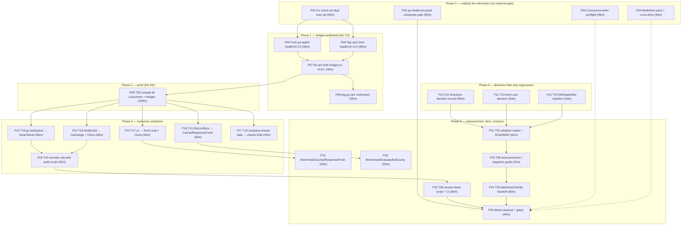

# Consumption Wave — from a released library to repos that actually use it

**Created:** 2026-10-27 21:12 CET · **Status:** PLAN (not executed) · **Repo of record:** `github.com/larsartmann/go-health`
**Predecessors:**
[plan 19:18 (execution order, T01–T30)](2026-10-27_19-18_fleet-supplier-wave-release-plan.md) ·
[needs study](../research/2026-10-27_fleet-consumer-needs.md) ·
[21:02 status (distribution shipped)](../status/2026-10-27_21-02_distribution-shipped-consumption-zero.md)

> **Why a second plan.** The 19:18 plan assumed the release was the bottleneck. It was, and it is
> now solved: v0.8.1 is tagged, pushed, on the proxy, has a readable release page, is marked
> *Latest*, and its CI is green on all five jobs. The bottleneck has **moved**. A released library
> that no bridge publishes and no app compiles buys exactly nothing. This plan starts where the
> 19:18 plan stopped being true, and it retires the tasks that are already done rather than
> re-listing them.

---

## 0. Where we actually are (verified 2026-10-27 21:12)

| Fact | Value | Verified by |
| --- | --- | --- |
| go-health release | `v0.8.1` (Latest), `v0.8.0` superseded | `gh release list` |
| Tag CI | v0.8.1 5/5 green · master 5/5 green | runs 40570901800, 40570904188 |
| Proxy | `… v0.7.0 v0.8.0 v0.8.1` | `go list -m -versions` |
| Local gates | `nix run .#gates` **exit 0**; lint 0 issues; fmt clean | this session |
| Open issues | **0** (#6, #7 closed with evidence) | `gh issue list --state open` |
| `go-appkit/health` | master pushed, **`health/v0.3.0` tag local-only** | `git ls-remote \| grep -c` → 0 |
| `cqrs-htmx/health` | bump on origin/master, **no `health/v4.x` tag** (latest is v4.13.0) | `git ls-remote --tags` |
| `cqrs-htmx` worktree | on branch `docs/health-recorder-refusal-note`, **PR #37 OPEN** | `gh pr view 37` |
| Consumer pins | DiscordSync v0.7.0 · dnsblockd v0.5.1 · cv v0.5.1 · go-taskqueue v0.7.0 · company-master-data v0.7.0 | `go.mod` in each |
| Consumer worktrees | all 5 clean, all on `master` | `git status --short` |
| Broken mechanic | `scripts/check-art-dupl.sh` has **no exec bit** → `pre-tag-checks.sh` fails for anyone | `ls -l` → `-rw-r--r--` |

**Reach arithmetic.** 36 dashboard consumers, 15 direct. `cqrs-htmx/health` carries ~20 apps,
`go-appkit/health` ~4+. Both bridges are unreleased at this SDK ⇒ **reachable but not reachable
through the bridges = 0 delivered**.

---

## 1. Pareto

### The 1% that delivers 51% — one task

| Slice | Task | Why it is 51% |
| --- | --- | --- |
| **1%** | **P06 — publish `cqrs-htmx/health` at the bumped SDK** | ~20 of the 36 consumers resolve go-health *only* through this bridge. It is already bumped, tested and on origin/master; the sole missing artifact is a module tag. One tag converts a released library into fleet-reachable code for the majority of the reach. Zero code is written. |

### The 4% that delivers 64% — four tasks

| Slice | Tasks | Why it is 64% |
| --- | --- | --- |
| **4%** (4/25) | **P05** (push `go-appkit/health` v0.3.0) + **P06** (tag `cqrs-htmx/health`) + **P07** (re-pin both to one version) + **P09** (compile all 5 consumers + both bridges against the release) | Two published bridges cover the whole 36. But a bridge release nobody compiles against is an unverified claim — §d of the last report was exactly that mistake in a different costume. P09 is the proof, and it is cheap because the consumers already build. |

### The 20% that delivers 80% — seven tasks

| Slice | Tasks | Why it reaches 80% |
| --- | --- | --- |
| **~20%** (7/25) | **P01** (fix the exec bit) · **P02** (pre-push composite gate) · **P05** · **P06** · **P07** · **P09** · **P10** (shutdown decision record) | P01 is 5 minutes and unblocks every future tag in go-appkit. P02 is the mechanism that prevents the v0.8.0 repeat. P10 freezes a behaviour two agents have already tried to "fix" in opposite directions. With the four delivery tasks that is the whole spine: **truth, mechanism, release, proof, decision.** |

### The other 20% — the last fifth of the value

| Slice | Tasks | What it buys |
| --- | --- | --- |
| **~80%** (18 tasks) | consumer adoptions (P13–P17), remaining decisions (P11, P12), measurement (P19, P20), docs/process (P03, P04, P18, P21–P24), closeout (P25) | Deletes 4 hand-rolled cache adapters and ~120 lines of a duplicated prober, closes the drift class with a script, publishes the numbers behind two changelog claims, and hands the dashboard family what it asked for. Necessary for 100%; none of it can start before the spine. |

> **Rule:** no long-tail task may jump the spine. A consumer adoption pinned to an unpublished bridge
> is wasted work — that is precisely how tonight's go-appkit tag came to be useless.

---

## 2. Execution graph

**Critical path:** P01 → P05/P06 → P07 → P09 → (P13|P14) → P18 → P22 → P25 ≈ **11 h** of the ~25 h total.
**Highest risk edge:** P06 — it needs a version decision and touches a repo whose master has moved
under another session's landing lineage (PR #37 is open, `mergeable=UNKNOWN`).

---

## 3. Comprehensive plan — 25 tasks, 30–100 minutes each

Sorted by `Score = (Impact×2 + CustomerValue×2) − Effort/30`. Impact / CustomerValue are 1–5.

| # | Phase | Task (30–100 min) | Impact | Effort | Cust. value | Depends | Done when |
| --- | --- | --- | --- | --- | --- | --- | --- |
| P06 | Bridge | Publish `cqrs-htmx/health` at the bumped SDK: CHANGELOG cut, `health/v4.14.0` tag, release-train gate green, push, merge PR #37 | 5 | 90m | 5 | P01 | `git ls-remote` shows the tag; proxy serves it; ~20 apps can resolve |
| P05 | Bridge | Push `go-appkit/health` `health/v0.3.0`: re-run `pre-tag-checks.sh` green, push master+tag, verify | 5 | 60m | 5 | P01 | tag on origin; proxy serves v0.3.0 |
| P09 | Proof | T30: bump + build + test all 5 consumers and both bridges against the released API; one evidence table | 5 | 100m | 5 | P07 | table in a status doc; every row a command output |
| P01 | Mechanic | Fix `scripts/check-art-dupl.sh` exec bit (commit) so `pre-tag-checks.sh` passes for anyone | 4 | 30m | 4 | — | gate exits 0 with no `Permission denied` |
| P07 | Bridge | Re-pin both bridges to go-health **v0.8.1** so one library version has one CI story | 4 | 45m | 4 | P05,P06 | both `go.mod` say v0.8.1; suites green |
| P02 | Mechanic | go-health pre-push composite gate (runs `.#gates` + `docs-check` + `.#security`) wired into the release checklist | 4 | 30m | 4 | — | script exists, fails on a deliberate break, referenced by AGENTS |
| P10 | Decision | T22: shutdown-semantics decision record (one-way) + ADR entry + cross-links | 4 | 90m | 3 | — | decision doc exists; godoc/ADR/CHANGELOG agree |
| P13 | Adopt | T18 go-taskqueue → `health.NewChecks`; preserve startup/readiness semantics | 4 | 90m | 4 | P09 | ~120 lines deleted; suite green |
| P14 | Adopt | T16 dnsblockd → `CacheAge` replaces the timestamp check, `Response.Clone` replaces the manual clone | 4 | 90m | 4 | P09 | stale-path tests green; overlay kept |
| P22 | Drift | T09 version-skew script + CI wiring; update `consumer-verification.md` | 4 | 90m | 4 | P18 | script fails on deliberate drift; doc matches |
| P15 | Adopt | T17 cv → fresh read + `EvaluateAndCache` + `Clone`; keep the synthetic-row rule | 4 | 60m | 4 | P09 | suite green; off→warn rule intact |
| P16 | Adopt | T15 DiscordSync → `CachedResponseFresh` + `EvaluateAndCache`; keep 2× interval policy | 4 | 60m | 4 | P09 | suite green; policy documented |
| P18 | Tool | T20 fleet recorder mis-wire audit (detects the `ErrRecorderNotApplicable` class across 15 repos) | 3 | 45m | 3 | P13,P14 | script green across the fleet |
| P17 | Adopt | T19 company-master-data → wire `checks.Disk(cfg.DataDir, minFree)` | 3 | 45m | 4 | P09 | e2e green; disk row visible |
| P03 | Process | T27 concurrent-writer preflight (2 commands before each batch) into AGENTS (≤220 lines) + script | 4 | 45m | 2 | — | protocol written **and followed in this session** |
| P21 | Docs | T25 adoption matrix (7 new capabilities) + ROADMAP raw ideas | 3 | 60m | 2 | P10–P12 | matrix matches the fleet |
| P08 | Verify | pkg.go.dev render check for v0.8.0, v0.8.1, and both bridge versions | 3 | 30m | 4 | P07 | four URLs recorded and rendering |
| P23 | Docs | T08 announcement / consumer migration guide ("bump the bridge, delete your adapter") | 3 | 45m | 4 | P21 | doc exists, names the 3 change classes |
| P19 | Measure | `BenchmarkCachedResponseFresh` — prove the 0-alloc claim already published in the CHANGELOG | 3 | 20m | 2 | P15 | 0 allocs/op recorded in FEATURES |
| P20 | Measure | `BenchmarkEvaluateAndCache` — publish the number | 2 | 20m | 2 | P16 | ns/op recorded with provenance |
| P11 | Decision | T23: measure the double-fetch cost of `SourceStatuses` + `CachedResponse`, decide share vs document | 2 | 60m | 2 | — | decision recorded with numbers |
| P12 | Decision | T24: `WithStaleAfter` rejection record, cross-linked from the overlay note | 2 | 30m | 2 | — | doc exists; overlay note links it |
| P04 | Docs | T26/T28: markdown pass + cross-link both 18:57 reports from the research doc + index | 2 | 30m | 2 | — | dprint clean; links resolve |
| P24 | Handoff | T29: draft `HTMLDataAttrs` (fir DD9), dashboard#14, dashboard#17 | 3 | 60m | 3 | P23 | drafts ready to file per owner gate |
| P25 | Closeout | Final gates on all three repos + wave status report | 5 | 45m | 5 | P02,P22,P24 | one evidence table, all green |

**Totals:** 25 tasks · ~1,415 min ≈ **23.6 h** · 7 tasks (28%) deliver the first 80%.

**Retired from the 19:18 plan as already done:** T01, T02, T03, T04, T05, T06, T07 (proxy/consume
parts), T10 (code), T11 (code), T14, A01–A09. Do not re-execute them.

---

## 4. 12-minute breakdown — every task sliced

Each row ≤12 min. `V:` is the closing verification. No "looks fine".

| ID | ≤12-min task | Min | V |
| --- | --- | --- | --- |
| 01.1 | `chmod +x scripts/check-art-dupl.sh` in go-appkit | 2 | `ls -l` shows `x` |
| 01.2 | Run it directly, confirm exit 0 | 6 | `ART_DUPL_EXIT=0` |
| 01.3 | Re-run `scripts/pre-tag-checks.sh health/v0.3.0` end to end | 12 | no `Permission denied`, all guards OK |
| 01.4 | Commit the mode change with rationale | 5 | commit exists |
| 02.1 | Survey what `.#gates` actually runs today | 10 | list written down |
| 02.2 | Decide the pre-push script's step set (gates, docs, security) | 8 | decision noted |
| 02.3 | Write `tools/pre-push-gate.sh` with `set -euo pipefail` | 12 | script runs |
| 02.4 | Prove it fails: inject a deliberate lint break, run, revert | 10 | non-zero exit observed |
| 02.5 | Reference it from AGENTS release discipline (≤220 lines) | 8 | grep finds the reference |
| 02.6 | Commit | 5 | commit exists |
| 03.1 | Write the preflight rule (git log + mtime handshake) | 10 | rule text exists |
| 03.2 | Add it to AGENTS within the 220 cap | 10 | `wc -l` ≤ 220 |
| 03.3 | Write it as a script (`tools/who-touched.sh`) | 10 | runs, prints last 10 touches |
| 03.4 | Commit | 5 | commit exists |
| 04.1 | Cross-link both 18:57 reports from the research doc | 10 | links resolve |
| 04.2 | Index the 21:02 and this plan | 8 | rows present |
| 04.3 | `nix fmt` + docs-check | 10 | exit 0 |
| 04.4 | Commit | 5 | commit exists |
| 05.1 | Confirm go-appkit master is pushed and clean | 5 | `ahead=0` |
| 05.2 | Verify the tag's go.mod has no `replace`/`toolchain` | 6 | `git show tag:health/go.mod` clean |
| 05.3 | Push the tag | 5 | `git ls-remote` shows it |
| 05.4 | Poll the proxy for `health/v0.3.0` | 12 | `go list -m -versions` includes it |
| 05.5 | Record the evidence | 5 | row in status doc |
| 06.1 | Read cqrs-htmx release convention (tag shape, CHANGELOG) | 10 | convention written down |
| 06.2 | Cut the health CHANGELOG heading | 10 | heading present |
| 06.3 | Merge/rebase PR #37 first (or land it on master) | 12 | PR merged |
| 06.4 | Pull origin/master into a release branch | 8 | fast-forward or clean merge |
| 06.5 | Run `pre-tag-checks.sh health/v4.14.0` equivalent | 12 | green |
| 06.6 | Create the annotated tag | 6 | tag exists locally |
| 06.7 | Push tag + master | 6 | `ls-remote` shows both |
| 06.8 | Verify proxy + record | 10 | version resolves |
| 07.1 | Bump go-appkit health to v0.8.1 | 5 | tidy clean |
| 07.2 | Run its suite | 12 | green |
| 07.3 | Bump cqrs-htmx health to v0.8.1 | 5 | tidy clean |
| 07.4 | Run its suite + release-train check | 12 | green, 0 lag |
| 07.5 | Push both, commit | 8 | commits exist |
| 08.1 | Open pkg.go.dev for v0.8.1 | 6 | page renders |
| 08.2 | Open pkg.go.dev for v0.8.0 | 6 | page renders |
| 08.3 | Open pkg.go.dev for both bridge versions | 8 | pages render |
| 08.4 | Record four URLs | 4 | rows present |
| 09.1 | Write the eval loop (bump → tidy → build → test) as a script | 12 | runs on one repo |
| 09.2 | Run it on DiscordSync | 10 | PASS/FAIL row |
| 09.3 | Run it on dnsblockd | 10 | row |
| 09.4 | Run it on cv | 10 | row |
| 09.5 | Run it on go-taskqueue | 10 | row |
| 09.6 | Run it on company-master-data | 10 | row |
| 09.7 | Run it on both bridges | 12 | rows |
| 09.8 | Publish the evidence table | 10 | table in status doc |
| 10.1 | Re-read `Start`/`Shutdown` godoc for accuracy | 10 | no false claim |
| 10.2 | Write the decision record (one-way, with the counter-argument) | 12 | doc exists |
| 10.3 | Add the ADR entry and link it | 10 | ADR linked |
| 10.4 | Cross-link from CHANGELOG and the probe godoc | 10 | links resolve |
| 10.5 | Run go-health suite | 10 | green |
| 10.6 | Commit | 5 | commit exists |
| 11.1 | Add a benchmark calling both accessors | 12 | number captured |
| 11.2 | Compare against a single-read baseline | 10 | ratio captured |
| 11.3 | Decide share-one-pass vs document-2× | 12 | decision written |
| 11.4 | Implement or document | 12 | code/doc lands |
| 11.5 | Commit | 5 | commit exists |
| 12.1 | Write the rejection record | 10 | doc exists |
| 12.2 | Cross-link from `synthetic-check-overlay.md` | 8 | link resolves |
| 12.3 | Commit | 5 | commit exists |
| 13.1 | Read `queueProber` + its webui tests | 12 | behaviour map written |
| 13.2 | Map its checks onto `health.NewChecks` | 10 | names preserved |
| 13.3 | Replace the prober | 12 | compiles |
| 13.4 | Preserve startup/readiness semantics | 12 | tests green |
| 13.5 | Extend tests, run suite | 12 | green |
| 13.6 | Commit + record the deleted line count | 8 | commit exists |
| 14.1 | Read `health.go` + the stale-path tests | 12 | behaviour map |
| 14.2 | Swap the timestamp check for `CacheAge` | 10 | compiles |
| 14.3 | Swap the manual clone for `Response.Clone` | 10 | compiles |
| 14.4 | Extend the stale-path tests | 12 | green |
| 14.5 | Run the suite | 12 | green |
| 14.6 | Commit | 8 | commit exists |
| 15.1 | Read `project()` + synthetic-row tests | 12 | behaviour map |
| 15.2 | Replace fallback + clone | 12 | compiles |
| 15.3 | Keep the off→warn rule; adjust tests | 12 | green |
| 15.4 | Run the suite | 12 | green |
| 15.5 | Commit | 8 | commit exists |
| 16.1 | Read `readyzSnapshotCache` + tests | 12 | behaviour map |
| 16.2 | Replace with `CachedResponseFresh` + `EvaluateAndCache` | 12 | compiles |
| 16.3 | Keep the 2× interval policy; adjust tests | 12 | green |
| 16.4 | Run the suite | 12 | green |
| 16.5 | Commit | 8 | commit exists |
| 17.1 | Locate the company-master-data probe wiring | 10 | call site identified |
| 17.2 | Add `checks.Disk(cfg.DataDir, …)` | 10 | compiles |
| 17.3 | Extend the health/e2e test | 12 | green |
| 17.4 | Run the suite + commit | 10 | green |
| 18.1 | Define the mis-wire grep rule | 10 | rule written |
| 18.2 | Write the script over `tools/fleet-repos.txt` | 12 | runs |
| 18.3 | Run across 15 repos | 12 | table printed |
| 18.4 | Wire into go-health gates | 10 | referenced |
| 18.5 | Commit | 5 | commit exists |
| 19.1 | Add `BenchmarkCachedResponseFresh` | 10 | runs |
| 19.2 | Assert 0 allocs/op | 10 | `-benchmem` shows 0 |
| 19.3 | Record in FEATURES | 10 | row present |
| 19.4 | Commit | 5 | commit exists |
| 20.1 | Add `BenchmarkEvaluateAndCache` | 10 | runs |
| 20.2 | Record ns/op + provenance | 10 | row present |
| 20.3 | Commit | 5 | commit exists |
| 21.1 | Add the 7 capabilities to the adoption matrix | 12 | rows present |
| 21.2 | Fill per-repo adoption state | 12 | matrix matches reality |
| 21.3 | Route raw ideas into ROADMAP | 10 | ideas routed |
| 21.4 | Proofread for stale counts | 8 | grep clean |
| 21.5 | Commit | 5 | commit exists |
| 22.1 | Write `tools/version-skew.sh` skeleton | 10 | runs |
| 22.2 | Parse every consumer `go.mod` pin | 12 | 15 rows |
| 22.3 | Compare against published tags | 12 | drift detected |
| 22.4 | Non-zero exit on drift; deliberate-drift test | 10 | exit observed |
| 22.5 | Wire into gates + CI | 10 | referenced |
| 22.6 | Update `consumer-verification.md` | 10 | doc matches script |
| 22.7 | Commit | 5 | commit exists |
| 23.1 | Write the three change classes (additive/changed/fixed) | 12 | doc section |
| 23.2 | Write the "bump the bridge, delete your adapter" recipe | 12 | steps concrete |
| 23.3 | Proofread / voice pass | 8 | no overclaim |
| 23.4 | Commit | 5 | commit exists |
| 24.1 | Draft `HTMLDataAttrs` ask (fir DD9) | 12 | draft file |
| 24.2 | Draft dashboard#14 note | 10 | draft file |
| 24.3 | Draft dashboard#17 note | 10 | draft file |
| 24.4 | Commit drafts | 5 | commit exists |
| 25.1 | go-health: full gates | 12 | exit 0 |
| 25.2 | go-appkit: suite + pre-tag gate | 12 | green |
| 25.3 | cqrs-htmx: suite + release train | 12 | green |
| 25.4 | Five consumer suites | 12 | all green |
| 25.5 | Write the closeout status report | 12 | doc exists |
| 25.6 | Commit + push all three repos | 8 | in sync |

**Subtask total:** 122 rows · ≈ 1,130 min of the 1,415 (the task table carries ~285 min of retries,
gate waits and cross-repo overhead).

---

## 5. Gates and verification per phase

| Phase | Gate | Command / evidence | Fail action |
| --- | --- | --- | --- |
| 0 | Formatter | `nix fmt` | fix, re-run |
| 0 | Composite | `nix run .#gates` (exit code **with `set -o pipefail`**) | stop, fix |
| 1 | Tag hygiene | `git show <tag>:<module>/go.mod` — no `replace`, no `toolchain` | fix before push |
| 1 | Pre-tag | `scripts/pre-tag-checks.sh <tag>` | do not push |
| 1 | Proxy | `go list -m -versions` contains the tag | retry, then report |
| 1 | Release train | `nix run .#check-release-train -- --strict-lag 0` | run the documented `bump-dep.sh` sweep |
| 2 | Consumer compile | per-repo `go build ./... && go test ./...` | that repo's row is FAIL; do not adopt it |
| 3 | Decision records | file exists, linked from the code it governs | not done |
| 4 | Consumer suites | per-repo, plus e2e where present | revert that adoption only |
| 5 | Final | one evidence table: 3 repos + 2 bridges + 5 consumers | stop, do not claim done |

**Never:** tag before the pre-tag gate; adopt a consumer before P07; declare a release done without
its release page; trust an `EXIT=` line that came through a pipe.

---

## 6. Verschlimmbesser guards (non-negotiable)

1. **No API removal, no wire change, no default flip.** This wave delivers; it does not redesign.
2. **One release in flight per repo.** Do not tag a bridge twice in one wave; supersede instead.
3. **Never move a published tag.** v0.8.0 stays red and disclosed; v0.8.1 is the answer.
4. **Never revert another session's work.** Read it, judge it, reconcile it.
5. **`git add` by path, never `-A`.** Tonight's four commits carrying peer work is the cautionary
   tale; the tree changes between your edit and your add.
6. **`set -o pipefail` on every verification command.** Two false greens tonight came from a pipe.
7. **Verify the delivering layer.** A tag is done when the proxy serves it and a foreign module
   resolves it — not when `git tag` printed something.
8. **Stop the line on red.** A failing gate is never "probably unrelated".
9. **AGENTS.md ≤ 220 lines**; new detail goes to a linked doc.
10. **No new runtime dependency.**
11. **One repository per commit**; a broken consumer tree is reverted for that repo only.
12. **Do not edit a consumer repo without its owner's go-ahead** — P13–P17 are gated on that answer.
13. **Preflight before every batch** (`P03`): `git log --oneline -10` + newest-file mtime. If the tree
    changed since your last read, re-read before writing.
14. **Fix the mechanism, not the symptom.** Tonight's exec-bit workaround left the trap armed; P01
    exists so that never repeats.
15. **A decision that is only "documented" is not decided** — P10/P11/P12 produce records, because two
    agents have already tried to move the shutdown latch in opposite directions.

---

## 7. Definition of done (whole wave)

- `cqrs-htmx/health` and `go-appkit/health` are **published** at the bumped SDK and both pin **v0.8.1**.
- **All five consumers compile and test green** against the released API, in one evidence table.
- Four hand-rolled cache adapters are gone or reduced to the sanctioned primitives; go-taskqueue's
  duplicated prober is deleted.
- Three decision records exist (shutdown, fetch cost, staleness policy) and are linked from the code
  they govern.
- Version skew is detectable by script and wired into CI; `consumer-verification.md` matches it.
- Both changelog claims that name a number (0-alloc, ns/op) are backed by a benchmark in the repo.
- Every repo pushed; every tag's CI green; no local-only tags anywhere.
- One closeout status report with a complete evidence table and an honest failure list.

---

## 8. Open questions that block specific rows

| Gate | Question | Blocks |
| --- | --- | --- |
| **Q1** | Version scheme for the bridge releases: is `health/v0.3.0` + `health/v4.14.0` right, or does the family use a different convention? | P05, P06 |
| **Q2** | May I edit the five consumer repos directly, or draft the diffs per repo? | P13–P17 |
| **Q3** | Is another agent working `go-health` / `cqrs-htmx` right now, and should I wait it out or proceed and reconcile? | everything touching shared files |

*Nothing in Phase 0 is blocked. P01–P04 can start immediately.*

---

## Appendix — evidence map

| Claim | Source |
| --- | --- |
| v0.8.1 Latest, v0.8.0 superseded | `gh release list` |
| Tag + master CI green 5/5 | runs 40570901800, 40570904188 |
| Proxy has v0.8.0/v0.8.1 | `go list -m -versions github.com/larsartmann/go-health` |
| `health/v0.3.0` local only | `git ls-remote --tags origin \| grep -c` → `0` |
| cqrs-htmx latest health tag v4.13.0 | `git ls-remote --tags origin \| grep health/v4` |
| PR #37 open | `gh pr view 37 --json state` |
| Consumer pins | each repo's `go.mod` (`v0.5.1` ×2, `v0.7.0` ×3) |
| Exec bit broken | `ls -l scripts/check-art-dupl.sh` → `-rw-r--r--` |
| Gates green | `nix run .#gates` → "all gates green", exit 0 |
| 36 consumers / 15 direct / 3 bridges | [needs study §1](../research/2026-10-27_fleet-consumer-needs.md) |
