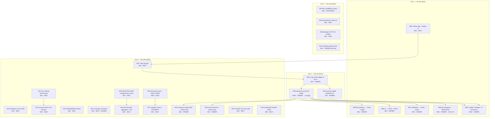

# Wave 2 — closing the consumption gap (Pareto master plan)

**Created:** 2026-10-27 21:12 CET · **Repo:** `github.com/larsartmann/go-health` · **Branch:** `master` (clean, in sync)
**Supersedes as the actionable plan:** `2026-10-27_19-18_supplier-wave-v080-from-primitives-to-fleet.md` (its distribution half is shipped) and `2026-10-27_19-18_fleet-supplier-wave-release-plan.md` (T01–T30; its executed rows are corrected in §7 Errata).
**Inputs read before ranking:** `TODO_LIST.md`, `ROADMAP.md`, `FEATURES.md`, `docs/status/2026-10-27_21-02_distribution-shipped-consumption-zero.md` (peer, newest), `docs/status/2026-10-27_21-00_…` (mine), `docs/research/2026-10-27_fleet-consumer-needs.md`, `docs/consumer-verification.md`, `docs/adoption-matrix.md`, `CHANGELOG.md`, current code + `flake.nix`.

---

## 0. Where we actually are (verified, 21:12)

| Layer                      | State                                                                                                                                                                                                                   | Evidence                                                                                      |
| -------------------------- | ----------------------------------------------------------------------------------------------------------------------------------------------------------------------------------------------------------------------- | --------------------------------------------------------------------------------------------- |
| Library (this repo)        | `v0.8.0` + `v0.8.1` tagged, pushed, proxy-served, CI 5/5 green on master and on the v0.8.1 tag; issues #5/#6/#7 closed; `nix run .#gates` exit 0                                                                        | peer verification log 21:02; I re-ran `test-race`, `.#docs-check`, `.#fuzz-registry` at 21:00 |
| Repo hardening             | coverage **99.9% total / 100% root**; fuzz-registry parity gate; `[Unreleased]` + federation-API docs gates; `AGENTS.md` 181 lines; `docs/ARCHITECTURE.md`                                                              | my 21:00 report §a                                                                            |
| Bridges (2 repos)          | **half-shipped.** `go-appkit/health` v0.3.0 tagged **locally only** (unpushed, proxy cannot see it); `cqrs-htmx/health` bumped on origin/master with **no module tag** (latest is `health/v4.13.0`), README PR #37 open | peer §b1/b2                                                                                   |
| Consumers (5 target repos) | **zero adopted.** dnsblockd, DiscordSync, cv, go-taskqueue, company-master-data all still run their hand-rolled adapters                                                                                                | peer §c1–c5                                                                                   |
| Fleet size                 | 36 repos can `go get` the wave; **0** can consume it through a bridge; **0** apps compiled against it                                                                                                                   | peer TL;DR + `docs/research/…-needs.md`                                                       |

**The one sentence that decides this plan:** the wave's _supply_ is finished and its _consumption_ is zero, so every remaining percent of value is on the other side of six repositories — not in this one.

### What that means for "what should we really do"

Three actions account for more than half the total achievable value, and two of them are one-command operations that are already prepared:

1. **A local tag nobody can resolve is worse than no tag** (`go-appkit/health` v0.3.0). Push it.
2. **`cqrs-htmx/health` has no tag at all** — and it is the bridge that ~20 of the 36 consumers reach the wave through. One annotated tag + push is the single largest lever on the board.
3. **Both bridges pin v0.8.0 while the green story is v0.8.1** — re-pin before tagging, or we mint two releases pinned to the version whose CI was red.

---

## 1. Pareto breakdown

### 1.1 The 1% that delivers 51%

| Lever                                                                                            | Why it is the 1%                                                                                                                                                                                                              | Effort      | Value unlocked                                           |
| ------------------------------------------------------------------------------------------------ | ----------------------------------------------------------------------------------------------------------------------------------------------------------------------------------------------------------------------------- | ----------- | -------------------------------------------------------- |
| Re-pin both bridges to **v0.8.1**, then **tag + push** `go-appkit/health` and `cqrs-htmx/health` | A bridge release is the only path for ~24 of 36 consumers. Neither tag is resolvable today, so the whole wave is stuck at the bridge boundary. Re-pinning first is what stops us minting releases against the red-CI version. | **~40 min** | the entire bridge tier (~24 repos) becomes `go get`-able |

### 1.2 The 4% that delivers 64%

| Lever                                                                                     | Why                                                                                                                                                                      | Effort  | Value unlocked                                        |
| ----------------------------------------------------------------------------------------- | ------------------------------------------------------------------------------------------------------------------------------------------------------------------------ | ------- | ----------------------------------------------------- |
| **Compile 2 bridges + 5 consumers against the release; publish one evidence table** (T30) | "Shipped" is a distribution claim. One compile per repo converts it into adoption evidence — and it is the only way to catch a broken bridge before 20 apps discover it. | 100 min | proof that 1.1 actually works                         |
| **Version-skew app + CI wiring** (T09)                                                    | `tools/fleet-skew.sh` exists and nothing runs it; drift is currently invisible until a repo fails to build.                                                              | 60 min  | permanent visibility on the remaining 30 repos        |
| **go-taskqueue** → `health.NewChecks` (T18)                                               | Biggest deletion on the board (~120 lines of duplicated prober), self-contained, no new dependency.                                                                      | 90 min  | one real adopter; proves the checks API in production |
| **dnsblockd** → `CacheAge` + `Response.Clone` (T16)                                       | The repo that actually crashed on the aliasing hazard; removes both workarounds at once.                                                                                 | 90 min  | one real adopter; retires a documented footgun        |

### 1.3 The 20% that delivers 80% (the rest of the adoption + the decisions behind it)

| Lever                                                                                               | Why                                                                                                              | Effort  |
| --------------------------------------------------------------------------------------------------- | ---------------------------------------------------------------------------------------------------------------- | ------- |
| cv (T17) + DiscordSync (T15) adoptions                                                              | Same class as dnsblockd; completes the freshness-primitive story across the fleet.                               | 120 min |
| company-master-data → `checks.Disk` (T19)                                                           | Its own research scored `checks` "unused"; the batteries need one named adopter.                                 | 45 min  |
| Fleet recorder mis-wire audit (T20)                                                                 | Mechanizes the trap class (`RecordHealthCheckWithContext` silently dropped) instead of documenting it again.     | 60 min  |
| Three decision records (T22 shutdown re-arm, T23 accessor fetch cost, T24 `WithStaleAfter` refusal) | Documented ≠ decided. The next agent will "restore" a broken re-arm or add the policy option unless these exist. | 180 min |
| Benchmarks for the two unmeasured claims (`CachedResponseFresh` 0-alloc, `EvaluateAndCache`)        | A published changelog claim with no measurement is a liability.                                                  | 40 min  |
| Coverage floor + API-lockstep for aggregate/root + ARCHITECTURE completeness (this repo)            | The three checks that stop this repo's own drift class from reopening.                                           | 140 min |
| `.#gates` as the only pre-tag gate + a `.#pre-tag` app                                              | The v0.8.0 red-CI incident was a missing gate invocation, not a missing gate.                                    | 45 min  |
| Adoption matrix + ROADMAP (T25), announcement (T08), dashboard handoff (T29)                        | The consumption wave needs a story a human reads, not a capability table.                                        | 160 min |

### 1.4 The remaining 20% (to reach 100%)

| Item                                                                     | Why it is in the tail                                                                           | Gate            |
| ------------------------------------------------------------------------ | ----------------------------------------------------------------------------------------------- | --------------- |
| BuildFlow upstream issues (dprint `--fix`, full-mode spawn env)          | Real, proven, but affects only this maintainer's loop; needs source-level verification.         | upstream        |
| BuildFlow `golangci-lint [tools/doanalyzerv2]` step env + profile binary | Documented four times; blocked on a buildable BuildFlow.                                        | upstream        |
| golangci LSP fix-or-disable                                              | Fifth session of false diagnostics; costs minutes per session, not correctness.                 | self            |
| Breaking window: `SanitizeResponse` alias, `Check.Since` → `StatusSince` | Low break surface (dashboard only), rides the next minor that already breaks something.         | owner go/no-go  |
| `WithCriticalServices(...ServiceName)` clean cut                         | Highest break surface (8 constructor repos + 2 bridges); needs the owner's typed-identity call. | owner decision  |
| `Probe`/`Prober`/`Source`/`Remote` lexicon reconciliation                | Highest coupling, lowest lie-factor — explicitly deferred by A22.                               | owner, deferred |
| samber-do-auditlog `DetailedHealthRecorder` implementor                  | Requires reversing ADR-004's dependency-free decoupling.                                        | owner decision  |
| Normalize `tools/doanalyzerv2` go directive                              | Not a local lever (`tidy` re-bumps); waits on a samber-linter release.                          | upstream        |
| Publish v0.1.1/v0.1.2 announcement, samber/do#318 comment                | Drafts ready; publishing is the owner's act in third-party channels.                            | owner           |
| ROADMAP ideas (multi-arch/darwin, Podman healthcheck, etc.)              | Vision, not work.                                                                               | owner / later   |

---

## 2. Comprehensive plan — 27 milestones (30–100 min each), sorted by value ÷ effort

`Gate`: **SELF** = this repo, I can execute · **OWNER** = needs your write/publish authority · **UPSTREAM** = third-party repo · **BLOCKED** = waiting on a decision or an external release.
`Value`: customer/consumer value delivered (not effort).

| ID  | Milestone (30–100 min)                                                                                                                             | Outcome / customer value                                                          | Effort | Gate                | Depends on     |
| --- | -------------------------------------------------------------------------------------------------------------------------------------------------- | --------------------------------------------------------------------------------- | ------ | ------------------- | -------------- |
| M01 | Re-pin both bridges to v0.8.1 and verify each `go.mod` + CI story                                                                                  | one library version, one CI story; no release minted against the red-CI tag       | 30m    | OWNER               | —              |
| M02 | Fix `go-appkit scripts/check-art-dupl.sh` exec bit, push `health/v0.3.0`, verify proxy resolution                                                  | a tag that `go get` can actually resolve; gate green for the next tagger          | 30m    | OWNER               | M01            |
| M03 | Tag + push `cqrs-htmx/health` (next `health/v4.x`), land README PR #37, re-verify release-train lag 0                                              | **the ~20-app unblock** — largest single lever on the board                       | 100m   | OWNER               | M01            |
| M04 | Fleet verification table: compile 2 bridges + 5 consumers against the release, publish evidence (T30)                                              | adoption becomes measured fact instead of a claim                                 | 100m   | OWNER               | M02, M03       |
| M05 | Version-skew app (`.#skew`) + weekly CI job with a pinned expectation (T09)                                                                        | drift visible forever; the next bump is measured, not discovered by a red build   | 60m    | SELF                | —              |
| M06 | go-taskqueue → `NewChecks` + `WithRefreshInterval(0)` + live throttle (T18)                                                                        | ~120 lines deleted; first production `checks` adopter                             | 90m    | OWNER               | M02/M03        |
| M07 | dnsblockd → `CacheAge`/`CachedResponseFresh` + `Response.Clone` (T16)                                                                              | retires the aliasing footgun in the repo that hit it                              | 90m    | OWNER               | M02/M03        |
| M08 | cv → `CachedResponseFresh`/`EvaluateAndCache` + `Clone`, keep its synthetic-row rule (T17)                                                         | freshness primitives proven across a second shape                                 | 60m    | OWNER               | M02/M03        |
| M09 | DiscordSync → `CachedResponseFresh`/`EvaluateAndCache` + `WithCriticalService[T]` (T15)                                                            | removes its readyz snapshot cache + label table duplication                       | 60m    | OWNER               | M02/M03        |
| M10 | Decision record: one-way shutdown / no re-arm (T22)                                                                                                | the latch cannot be "helpfully restored" by the next agent                        | 90m    | SELF                | —              |
| M11 | Decision record + measurement: calling `CachedResponse` and `SourceStatuses` costs two fetch passes (T23)                                          | a documented cost with numbers, or a merge of the two read paths                  | 60m    | SELF                | —              |
| M12 | Decision record: `WithStaleAfter` deliberately not shipped (T24)                                                                                   | kills the "overlay note implies a policy option" ambiguity                        | 30m    | SELF                | —              |
| M13 | Benchmarks for the two published claims: `CachedResponseFresh` (0 allocs) and `EvaluateAndCache`                                                   | every changelog claim measurable; numbers into FEATURES                           | 40m    | SELF                | —              |
| M14 | Coverage-threshold machinery (app + CI) at the measured floor, default report-only pending policy                                                  | 99.9% becomes enforced instead of aspirational                                    | 40m    | SELF→OWNER (enable) | —              |
| M15 | Extend the docs-check API lockstep to `aggregate.Aggregate` and root `*Probe`                                                                      | the drift class that hid `SourceStatuses`/`Healthz` closed for all three surfaces | 60m    | SELF                | —              |
| M17 | Adoption matrix + ROADMAP: the 7 new capabilities, per-repo state (T25)                                                                            | answers "who uses what" without reading 36 repos                                  | 60m    | SELF                | —              |
| M18 | Owner publishing batch: v0.8.x announcement with "bump the bridge, then delete your adapter" (T08) + samber/do#318 comment + v0.1.1/v0.1.2 post    | readers learn the migration, not the feature list                                 | 40m    | OWNER               | M03            |
| M19 | company-master-data (forgejo, manual) → `checks.Disk` (T19)                                                                                        | a named `checks` adopter; closes a scored "unused capability"                     | 45m    | OWNER               | M02/M03        |
| M20 | Fleet recorder mis-wire audit: detect silently dropped `RecordHealthCheckWithContext` (T20)                                                        | the trap class becomes mechanical, not folklore                                   | 60m    | SELF                | —              |
| M21 | Dashboard-family handoff drafts: `HTMLDataAttrs` (fir DD9), dashboard#14, dashboard#17, hub SIGTERM → `MarkShuttingDown`                           | the drain feature's actual payoff, drafted where it can be merged                 | 60m    | SELF (draft)        | —              |
| M22 | Docs/story pass: dprint markdown over tonight's docs (T26), concurrent-writer preflight (T27), cross-links (T28), TODO_LIST refresh                | the repo's own paper trail stops being three overlapping reports                  | 100m   | SELF                | —              |
| M23 | `.#pre-tag` app: gates + security + vulncheck + docs + skew in one non-zero-exiting command; CONTRIBUTING points at it                             | the v0.8.0 red-tag failure cannot recur by omission                               | 45m    | SELF                | M05            |
| M24 | BuildFlow upstream: file the two proven gaps (dprint `--fix` no-rewrite; full-mode spawn env ignores `GOTOOLCHAIN`) with source-level verification | two recurring frictions get owners upstream                                       | 90m    | UPSTREAM            | —              |
| M25 | `golangci-lint [tools/doanalyzerv2]` step env fix (`GOWORK=off`, `GOTOOLCHAIN`) or a documented non-fix with proof                                 | removes one of three standing BuildFlow reds                                      | 45m    | SELF                | —              |
| M26 | golangci LSP: fix the stale-diagnostics integration or disable it in the Crush config                                                              | five sessions of false findings end; the panel stops costing minutes              | 30m    | SELF                | —              |
| M27 | Breaking window prep: `SanitizeResponse` → `CoerceValidUTF8` alias, `Check.Since` → `StatusSince` (JSON frozen)                                    | the two cheap A22 renames land in the next minor                                  | 60m    | OWNER               | owner go/no-go |

**Sums:** SELF-executable now = M05, M10–M17, M20–M22, M23, M25, M26 (820 min ≈ 13.7 h). OWNER-gated = M01–M04, M06–M09, M18, M19, M27 (705 min ≈ 11.8 h). UPSTREAM = M24 (90 min). Total 1615 min ≈ 26.9 h.

### 2.1 What I execute without asking (this file's implied first batch)

M05, M10–M17, M20–M23, M25, M26 — they are all inside this repo, all verifiable by `nix run .#gates`, and none touches a wire format or a public API. Order: **M23 → M14 → M15 → M16 → M13 → M11 → M12 → M10 → M05 → M17 → M20 → M21 → M22 → M25 → M26** (mechanisms before prose, measurements before decision records).

---

## 3. Fine breakdown — every milestone in ≤12-minute subtasks (106 tasks)

Sorted by value ÷ effort within each milestone; milestone order follows §2.

| ID    | Subtask (≤12 min)                                                                       | Parent |
| ----- | --------------------------------------------------------------------------------------- | ------ |
| S01.1 | Read both bridges' `go.mod` + release notes; record current pins                        | M01    |
| S01.2 | Bump `go-appkit/health` pin to v0.8.1, run its suite                                    | M01    |
| S01.3 | Bump `cqrs-htmx/health` pin to v0.8.1, run its suite                                    | M01    |
| S01.4 | Re-run each bridge's `--strict-lag` check; record the output                            | M01    |
| S02.1 | `chmod +x scripts/check-art-dupl.sh` in go-appkit, commit                               | M02    |
| S02.2 | Run `scripts/pre-tag-checks.sh` without the `bash` workaround                           | M02    |
| S02.3 | Push `health/v0.3.0` (annotated) to origin                                              | M02    |
| S02.4 | Verify with `go list -m -versions` and a clean-module `go get`                          | M02    |
| S03.1 | Confirm the next `health/v4.x.y` number and the tag scheme with `git tag -l`            | M03    |
| S03.2 | Run cqrs-htmx/health's suite on the v0.8.1 pin                                          | M03    |
| S03.3 | Annotate + push the health tag; verify it resolves from a foreign module                | M03    |
| S03.4 | Resolve PR #37 (merge or rebase); confirm `mergeable`                                   | M03    |
| S03.5 | Re-run the release-train lag check across its internal requires                         | M03    |
| S03.6 | Record the bridge release table (repo, tag, pin, CI) in `docs/consumer-verification.md` | M03    |
| S04.1 | Write the compile harness (one command per repo, no state)                              | M04    |
| S04.2 | Compile go-appkit/health + cqrs-htmx/health against the released API                    | M04    |
| S04.3 | Compile dnsblockd, DiscordSync, cv, go-taskqueue, PlexSync/other against it             | M04    |
| S04.4 | Publish the evidence table (repo, version, result, date) in the docs                    | M04    |
| S04.5 | File every failure found as an issue in the owning repo                                 | M04    |
| S05.1 | Wrap `tools/fleet-skew.sh` as a flake app with a `--expect` flag                        | M05    |
| S05.2 | Decide the expectation source (manifest file, not a hand-typed version)                 | M05    |
| S05.3 | Add the weekly workflow job with the same command                                       | M05    |
| S05.4 | Run it once, record the baseline (`minor-stale` count)                                  | M05    |
| S06.1 | Read go-taskqueue's `health.go` + its tests                                             | M06    |
| S06.2 | Replace `queueProber` with `NewChecks` checks; keep the semantics                       | M06    |
| S06.3 | Delete the re-implemented `dashboard.Prober`; point at the real one                     | M06    |
| S06.4 | Run its suite + a live `/readyz` smoke                                                  | M06    |
| S06.5 | Commit with the deletion count in the message                                           | M06    |
| S07.1 | Read dnsblockd's zero-timestamp guard + `maps.Copy` overlay                             | M07    |
| S07.2 | Swap in `CachedResponseFresh`; keep the 15 s policy                                     | M07    |
| S07.3 | Swap the overlay copy for `Response.Clone`                                              | M07    |
| S07.4 | Run suite + the drain/shutdown path that motivated it                                   | M07    |
| S08.1 | Read cv's `internal/health/handlers.go`                                                 | M08    |
| S08.2 | Adopt `CacheAge`/`CachedResponseFresh` there                                            | M08    |
| S08.3 | Keep the synthetic-row rule; adopt `Clone` for the overlay                              | M08    |
| S08.4 | Run suite; record before/after line count                                               | M08    |
| S09.1 | Read DiscordSync's `health_readyz_cache.go` + `health_labels.go`                        | M09    |
| S09.2 | Replace the readyz snapshot with `CachedResponseFresh`/`EvaluateAndCache`               | M09    |
| S09.3 | Adopt `WithCriticalService[T]` + `DoServiceName` in the label table                     | M09    |
| S09.4 | Run suite; verify the label table output is byte-identical                              | M09    |
| S10.1 | Collect the re-arm attempts from git history + review comments                          | M10    |
| S10.2 | Write ADR-009 (or extend ADR-008's appendix) with the rejected alternatives             | M10    |
| S10.3 | Add the doc link at `MarkShuttingDown`/`Shutdown`                                       | M10    |
| S10.4 | Add a test that a second `Start` after `Shutdown` does not re-arm readiness             | M10    |
| S10.5 | Run gates                                                                               | M10    |
| S11.1 | Measure both calls separately and together (bench, `-count=3`)                          | M11    |
| S11.2 | Write the decision record with the numbers                                              | M11    |
| S11.3 | Add the "call one or the other" note to both accessors' godoc                           | M11    |
| S12.1 | Grep every mention of stale/overlay policy in docs                                      | M12    |
| S12.2 | Write the refusal record (why a policy option is the wrong seam)                        | M12    |
| S12.3 | Link it from `docs/cache-freshness-design.md`                                           | M12    |
| S13.1 | Add `BenchmarkCachedResponseFresh` (assert 0 allocs)                                    | M13    |
| S13.2 | Add `BenchmarkEvaluateAndCache`                                                         | M13    |
| S13.3 | Record median numbers in FEATURES "Performance" with the method                         | M13    |
| S14.1 | Add a `.#coverage-gate` app (thresholds total 99.5%, per-package 98%)                   | M14    |
| S14.2 | Wire it into `.#gates` in report-only mode                                              | M14    |
| S14.3 | Add the CI job (same command)                                                           | M14    |
| S14.4 | Document the floor + how to raise it in CONTRIBUTING                                    | M14    |
| S15.1 | Extract the lockstep block into a reusable shell function in the docs-check script      | M15    |
| S15.2 | Add an API block for `aggregate` to `docs/ARCHITECTURE.md`, then point the check at it  | M15    |
| S15.3 | Point it at root `*Probe` + `docs/ARCHITECTURE.md`/README API list                      | M15    |
| S15.4 | Prove both directions on a scratch copy before trusting it                              | M15    |
| S16.1 | Enumerate source files + ARCHITECTURE rows                                              | M16    |
| S16.2 | Add the bidirectional completeness check                                                | M16    |
| S16.3 | Prove it catches a planted file, then remove the plant                                  | M16    |
| S17.1 | Read the adoption matrix; list the 7 post-v0.6 capabilities                             | M17    |
| S17.2 | Fill per-repo state for the 15 direct consumers + 2 bridges                             | M17    |
| S17.3 | Update ROADMAP's "next" section to the consumption wave                                 | M17    |
| S18.1 | Write the announcement with the migration path (bump bridge → delete adapter)           | M18    |
| S18.2 | Post the samber/do#318 comment                                                          | M18    |
| S18.3 | Post the v0.1.1/v0.1.2 announcement                                                     | M18    |
| S19.1 | Read company-master-data's usage; confirm the forgejo-only path                         | M19    |
| S19.2 | Adopt `checks.Disk` on the data dir                                                     | M19    |
| S19.3 | Verify manually (forgejo, no CI) and record it                                          | M19    |
| S20.1 | Enumerate every `RecordHealthCheckWithContext` implementor + consumer                   | M20    |
| S20.2 | Write the detector (typed recorder vs plain map)                                        | M20    |
| S20.3 | Run it over the fleet manifest; record findings                                         | M20    |
| S21.1 | Draft `HTMLDataAttrs` (fir DD9) against the current templ-components API                | M21    |
| S21.2 | Draft dashboard#14 (Shutdown does not cancel Start's ctx)                               | M21    |
| S21.3 | Draft dashboard#17 (nightly fuzz)                                                       | M21    |
| S21.4 | Draft the hub SIGTERM → `MarkShuttingDown` change with its e2e assertion                | M21    |
| S22.1 | Run `nix develop -c dprint fmt`; commit the whitespace                                  | M22    |
| S22.2 | Write the concurrent-writer preflight (two commands, one claim file)                    | M22    |
| S22.3 | Add the cross-links between the 18:57 research doc and the 21:00/21:02 reports          | M22    |
| S22.4 | Rewrite TODO_LIST to the real state (v0.8.1 shipped, bridges half-released)             | M22    |
| S22.5 | Archive the superseded reports per the lifecycle rule                                   | M22    |
| S23.1 | Add `.#pre-tag`: gates + security + vulncheck + docs + skew, fail-fast with `EXIT=`     | M23    |
| S23.2 | Add the release-checklist guard: refuse when HEAD ≠ tag and `[Unreleased]` is empty     | M23    |
| S23.3 | Point CONTRIBUTING at `.#pre-tag` as the only pre-tag command                           | M23    |
| S23.4 | Run it; record the exit code                                                            | M23    |
| S24.1 | Reproduce the dprint `--fix` no-rewrite at source level (second confirmation)           | M24    |
| S24.2 | Search BuildFlow's open+closed issues for duplicates                                    | M24    |
| S24.3 | File the dprint issue                                                                   | M24    |
| S24.4 | Reproduce the spawn-env `GOTOOLCHAIN` gap at source level                               | M24    |
| S24.5 | File the spawn-env issue                                                                | M24    |
| S25.1 | Reproduce the fan-out failure in isolation (`GOWORK=off GOTOOLCHAIN=auto`)              | M25    |
| S25.2 | Determine whether `.buildflow.yml` `env:`/`tool_paths` can express the fix              | M25    |
| S25.3 | Apply the config fix or write the documented non-fix with proof                         | M25    |
| S26.1 | Reproduce a false diagnostic on a known-green file                                      | M26    |
| S26.2 | Try a config-level fix (timeout, module scope) in `crush.json`/LSP settings             | M26    |
| S26.3 | If unfixable: disable the integration and record why in AGENTS                          | M26    |
| S27.1 | Confirm the owner's go/no-go on the two cheap renames                                   | M27    |
| S27.2 | Add the `CoerceValidUTF8` alias + deprecation, update dashboard call sites              | M27    |
| S27.3 | Rename `Check.Since` → `StatusSince` with the JSON field frozen                         | M27    |
| S27.4 | Update `docs/check-metadata-design.md` + CHANGELOG migration note                       | M27    |
| S27.5 | Run gates + a wire-format regression test                                               | M27    |

_(106 subtasks across the 27 milestones: three or more per milestone, none longer than 12 min.)_

---

## 4. Execution graph

**Critical path:** `M23 → M01 → M03 → M04` (mechanism, pins, the ~20-app tag, the proof). Everything else is parallel-safe and repo-local.

---

## 5. Verification matrix

| Milestone          | Proof acceptable                                                                      |
| ------------------ | ------------------------------------------------------------------------------------- |
| M01                | both `go.mod` read v0.8.1; both suites green; lag check output recorded               |
| M02, M03           | `go list -m -versions` shows the tag; a foreign module `go get`s it; CI green         |
| M04                | one evidence table, one row per repo, each with the compiled version and date         |
| M05                | `nix run .#skew` exits 0 with the expected count; the workflow file is committed      |
| M06–M09, M19       | each repo's own suite green + the specific deletion/behavior asserted in its tests    |
| M10–M12            | the record exists, is linked from code, and names the rejected alternative            |
| M13                | benchmarks committed with numbers in FEATURES and the alloc claim verified or removed |
| M14, M15, M16, M23 | the new gate fails on a planted defect and passes on the clean tree                   |
| M17, M22           | no doc claims a release that does not exist; `nix run .#docs-check` green             |
| M18                | the posts exist at their URLs (owner)                                                 |
| M20, M21           | findings/drafts committed; each draft links the code it targets                       |
| M24                | two issue URLs                                                                        |
| M25, M26           | the red is gone or the non-fix names the evidence that it cannot be fixed here        |
| M27                | wire format unchanged (golden test), dashboard compiles, gates green                  |

---

## 6. Risks and anti-Verschlimmbesserung guards

1. **Do not mint a bridge release against v0.8.0.** M01 must precede M02/M03, or we publish two bridges pinned to the tag whose CI was red.
2. **Never move a published tag.** If a bridge release is wrong, supersede it.
3. **One repo per commit, one commit per repo** for every consumer milestone; revert that repo alone on red.
4. **No new public API in this wave.** M13–M16 add tests and gates only; M27 is the only surface change and it is owner-gated.
5. **Mechanisms before prose.** A decision record without a test is a comment; M10 ships both.
6. **Do not add gates that cannot run hermetically** (see the dprint/markdown non-fix in AGENTS.md — the sandbox has no plugin download).
7. **Do not chase 100% coverage by deleting error handling** (the one uncovered statement in `federation.fetch` stays, documented).
8. **Concurrent agents:** before each batch, `git status` + `git log --oneline -3`, and never `git add -A` (the peer has already swept unreviewed work into commits).

---

## 7. Errata — stale backlog rows corrected while reading

| Stale claim                                                                         | Reality (2026-10-27 21:12)                                                                                |
| ----------------------------------------------------------------------------------- | --------------------------------------------------------------------------------------------------------- |
| `TODO_LIST` "Cut v0.8.0 … READY — pushing master + tag is the owner act"            | v0.8.0 **and** v0.8.1 are tagged, pushed, proxy-served, CI-green, released. Row is obsolete.              |
| `TODO_LIST` consumer rows "BLOCKED on the v0.8.0 cut"                               | The cut landed. They are blocked on **write authority**, not on the release.                              |
| `TODO_LIST` "Version-skew CI script … BLOCKED on push authority"                    | Half-false: the script exists (`tools/fleet-skew.sh`) and nothing runs it; CI wiring is the missing part. |
| `docs/status/…20-17` §b "BuildFlow 3 failures, doanalyzerv2 lint is a step-env bug" | Still true, but now has a milestone (M25) instead of a note.                                              |
| `docs/planning/…19-18_supplier-wave` milestone checkboxes                           | Distribution milestones did execute; the plan's boxes were never ticked. This file is the successor.      |
| `TODO_LIST` coverage figure 99.1%                                                   | 99.9% total, 100% root (measured 2026-10-27 20:5x).                                                       |
| Peer report §b3 "both bridges pinned to v0.8.0"                                     | Now a milestone (M01) rather than a footnote — it is the cheapest correctness win on the board.           |

---

## 8. What I need from you (three questions, unchanged)

1. **Who else is writing this repo?** A peer session cut both tags, wrote two 21:02 reports, and edited files mid-read. Coordination (claim file / one session per repo) is M-unassigned; without it the verification loop is unsound.
2. **Is this repo's ranking right?** I ranked adoption (M01–M09) above hardening (M10–M17) because the wave's value is zero until a consumer compiles. If you would rather I keep hardening this repo first, say so — it changes the order, not the content.
3. **Do I have push/write authority for the six repositories in M01–M09/M19?** That is ~11.8 h of the plan's total value and every one of those milestones is OWNER-marked. With a yes I start at M01 and work down; the repo-local batch (M05, M10–M17, M20–M23, M25, M26) can start immediately either way.
